<div align="center">


**A real-time risk engine for Indian digital payments. It chooses the cheapest safe action for every UPI, IMPS, card and ATM payment, and says why in words an analyst or a customer can act on.**

[](https://github.com/antrikakashyap/fraud_hunter/actions)
[](#tests)
[](requirements.txt)
[](LICENSE)
[](#what-is-and-is-not-real)

<br>

### Live

[](https://fraud-hunter-api.onrender.com/)
[](https://antrikakashyap.github.io/fraud_hunter/)

<sub>The console on Render runs the real engine. It is on a free plan that sleeps when idle, so the first load can take 30 to 50 seconds. The Pages demo needs no server: it replays real recorded decisions. API docs: [`/docs`](https://fraud-hunter-api.onrender.com/docs).</sub>

<br>


</div>

## In 30 seconds

- **What it is:** a risk engine that looks at one Indian digital payment (UPI, IMPS, card or ATM) and answers **approve, step-up (ask for more proof) or decline in about a millisecond**, with the reasons in plain words.
- **What is inside:** 44 streaming features, an additive model written from scratch, escalate-only guardrail rules, an expected-cost policy, a mule graph, a Scam Shield for suspicious messages, and an analyst copilot that drafts the report.
- **What is real:** the payments in the simulator tabs are synthetic. The **Real data** tab runs on public datasets (ULB card fraud, real scam SMS) with the numbers and their limits shown. See [what is and is not real](#what-is-and-is-not-real).
- **Try it:** [live console](https://fraud-hunter-api.onrender.com/) (free plan, first load can take 30 to 50 seconds) or the [no-server demo](https://antrikakashyap.github.io/fraud_hunter/). Run it yourself with the steps in [DEPLOY.md](DEPLOY.md).

## The problem, in one story

> **Asha** is a schoolteacher in Patna. At 9 pm she gets an SMS: *"Your electricity connection will be disconnected tonight because your bill is not updated. Call 98xxxxxx immediately."* She calls. A polite "officer" says her bill needs a ₹10 "verification" and asks her to install a "support app". The app is a screen-sharing tool. While she watches her own phone, the officer opens her UPI app and sends **₹18,500 to a stranger's account**. The money moves in seconds. The stranger is a **mule**: a rented bank account that exists only to receive stolen money and pass it on.
>
> Her bank's old system looked at one thing: *is this payment unusual for Asha?* ₹18,500 is large for her, but not impossible. It was approved.

That is the everyday shape of Indian payment fraud. The customer is not hacked. The customer is **talked into paying**. A system that only scores "how unusual is this amount" misses it.

This project looks at everything around the payment instead, and it asks a different question. Not *"is this fraud?"* but:

> **What is the cheapest action, given what fraud costs and what blocking a good customer costs?**

On Asha's payment the engine sees a screen-sharing app running, a first-ever payment to this person, a payee that is a private account and not a shop, and an amount 18 times her usual. It declines, tells her in Hindi or English why, and tells her to call 1930. Here is the real output (more in [feature 5](#5-the-cheapest-action-wins)):

```text
Declined at 98.0% fraud risk. Rule SCREEN_SHARE_NEW_PAYEE fired.
Drivers: Screen-sharing or remote-access app active; First payment to this payee;
         Payee is a person or account, not a verified merchant.
Expected cost if approved ₹18,716 vs ₹8 for the chosen action.
```

The payment data is **synthetic**. The numbers in this README show the engineering, not real-world performance. Two parts have also been tested on **real public data**: the additive model on 284,807 real card transactions, and Scam Shield on about 55,000 real text messages, with the weak results left in ([docs/BENCHMARKS.md](docs/BENCHMARKS.md)). [What is and is not real](#what-is-and-is-not-real) says exactly where the line is.

## What you get

For every payment the engine returns **one of three answers**, a score, the reasons, and a message for the customer.

| Answer | Meaning | Example |
|---|---|---|
| **APPROVE** | Let it through. | ₹180 to the usual grocery shop, on the usual phone. Risk under 0.1%. |
| **STEP-UP** | Ask the customer to prove it is them (OTP or in-app confirmation) before releasing the money. | ₹22,000 card payment, first time on a brand-new phone, to a shop never paid before. |
| **DECLINE** | Stop it, and tell the customer how to report it. | ₹18,500 to a first-time person while a screen-sharing app is running. |

And around that core, **54 working features** that make it usable in the real world: a console with eleven tabs, a CSV backtest, an engine that attacks itself, a scam checker for customers, a mule-network graph, a Razorpay webhook, Telegram alerts, an analyst copilot, a fairness audit, SDKs, and a private way for banks to warn each other. They are all explained below, one by one, each with an example.

## Contents

**Start here:** [Hindi / हिन्दी](README.hi.md) · [Contributing](CONTRIBUTING.md) · [FAQ](docs/FAQ.md) · [Glossary](docs/GLOSSARY.md) · [Try it live](#try-it-live) · [Try it in 2 minutes](#try-it-in-2-minutes) · [How it works](#how-it-works) · [What is and is not real](#what-is-and-is-not-real)

**Part 1. The engine** (the decision itself)
[1 Streaming feature store](#1-a-memory-of-every-customer-that-never-peeks-ahead) · [2 Additive model](#2-a-model-that-shows-its-arithmetic) · [3 Logistic baseline](#3-an-honest-baseline) · [4 Guardrail rules](#4-guardrail-rules-that-can-only-escalate) · [5 Cost policy](#5-the-cheapest-action-wins) · [6 Rail-aware margin](#6-each-payment-rail-has-its-own-price) · [7 Two-phase step-up](#7-two-phase-step-up) · [8 Attempts vs trust](#8-attempts-count-trust-is-earned) · [9 Late and honest labels](#9-complaints-arrive-late-and-scam-victims-are-not-suspects) · [10 Windowed reputation](#10-reputation-that-forgets) · [11 Customer messages](#11-messages-in-hindi-and-english) · [12 Drift monitor](#12-a-drift-monitor-that-does-not-cry-wolf) · [13 Simulator](#13-a-simulated-india-to-learn-from)

**Part 2. The console** (what you click)
[14 Live ops](#14-live-ops) · [15 Review queue](#15-review-queue) · [16 Backtest](#16-backtest-replay-your-own-history) · [17 Red team](#17-red-team-the-engine-attacks-itself) · [18 Policy lab](#18-policy-lab) · [19 Playground](#19-playground) · [20 Model card](#20-model-card) · [21 Scam Shield](#21-scam-shield-check-before-you-pay) · [22 Mule graph](#22-mule-graph) · [23 Live wire](#23-live-wire) · [24 Fairness](#24-fairness-who-bears-the-friction)

**Part 3. Real-world plumbing**
[25 Razorpay webhook](#25-razorpay-webhook) · [26 IP intelligence](#26-ip-and-network-intelligence) · [27 Telegram and Slack alerts](#27-telegram-and-slack-alerts) · [28 Load test](#28-load-test) · [29 API key](#29-api-key) · [30 Audit log](#30-audit-log) · [31 Remembering state](#31-remembering-state-across-restarts) · [32 Analyst copilot](#32-analyst-copilot-briefs-and-str-drafts) · [33 AI wording](#33-optional-ai-wording-gemini-or-claude) · [34 Impossible amounts](#34-amounts-the-model-has-never-seen) · [35 Anonymous networks](#35-vpn-proxy-and-data-centre-networks)

**Part 4. Your own data**
[36 CSV ingest](#36-read-almost-any-csv) · [37 Fit to your CSV](#37-fit-the-model-to-your-csv) · [38 Leakage guard](#38-the-leakage-guard) · [39 Backtest from the command line](#39-backtest-from-the-command-line) · [40 No customer id](#40-when-the-file-has-no-customer-id)

**Part 5. Sharing and integrating**
[41 SDKs](#41-python-and-javascript-sdks) · [42 OpenAPI and Postman](#42-openapi-and-postman) · [43 Keyed-hash sharing](#43-banks-warning-banks-keyed-hashes) · [44 Private set intersection](#44-banks-warning-banks-without-sharing-a-key) · [45 Fairness audit](#45-fairness-audit-with-attributes-the-engine-never-saw)

**Part 6. Ship it**
[46 Docker](#46-docker) · [47 Render](#47-one-click-render-blueprint) · [48 Static demo](#48-a-demo-that-needs-no-server) · [49 GitHub Pages](#49-github-pages) · [50 CI](#50-continuous-integration) · [51 Demo video](#51-demo-video-and-script) · [52 Make targets](#52-one-line-commands)

**Part 7. Real public data**
[53 The Real data tab](#53-the-real-data-tab) · [54 Data provenance on every tab](#54-data-provenance-on-every-tab)

**The numbers and the honesty:** [Measured results](#measured-results) · [What failed first](#what-failed-first) · [Where it is weak](#where-it-is-weak-shown-not-hidden) · [Bounded by design](#bounded-by-design) · [Reference](#reference) · [Layout](#layout) · [Tests](#tests) · [Limitations](#limitations)

## Try it live

| | Link | What it is |
|---|---|---|
| **Full console** | https://fraud-hunter-api.onrender.com/ | The real engine, all eleven tabs, simulated traffic, the Scam Shield, the mule graph, the Live wire. The free plan sleeps when idle: wait up to a minute on the first load. |
| **Demo, no server** | https://antrikakashyap.github.io/fraud_hunter/ | One static page that replays real recorded decisions. Uploads, the webhook, alerts and the load test say they need a backend. |
| **Frontend for the hosted API** | https://antrikakashyap.github.io/fraud_hunter/live/ | The same console served from GitHub Pages, talking to the Render API. |
| **API reference** | https://fraud-hunter-api.onrender.com/docs | Interactive docs for every endpoint. |
| **Health check** | https://fraud-hunter-api.onrender.com/api/health | `{"ok": true, ...}` when the server is awake. |

Things to click first: **Launch attack → Vishing with screen-share** (Live ops), paste an SMS on **Scam Shield**, open **Mule graph**, and press **Run load test** on **Live wire**.

## Try it in 2 minutes

Python 3.12.

```bash
git clone https://github.com/antrikakashyap/fraud_hunter && cd fraud_hunter
python -m venv .venv && source .venv/bin/activate     # Windows: .venv\Scripts\activate
pip install -r requirements.txt
python -m fh.train                          # ~35 s: simulates 42 days, trains, evaluates, saves artifacts/
python -m uvicorn fh.api:app --port 8000    # now open http://localhost:8000
python -m pytest -q tests                   # 145 tests
```

No Python? `docker build -t fraud-hunter . && docker run -p 8000:8000 fraud-hunter`. No server at all? Open [`docs/index.html`](docs/index.html): a single file that replays real recorded decisions from disk.

**Your first score**, from a terminal:

```bash
curl -s localhost:8000/api/score -H 'content-type: application/json' -d '{
  "uid": "u0387", "mid": "newperson8841@ybl", "cat": "p2p", "amt": 18500,
  "chan": "upi", "pers": true, "rat": true, "city": "Mumbai", "commit": false }'
```

`rat: true` means "a screen-sharing or remote-access app is running". `commit: false` means "just tell me, do not remember this payment". The answer includes `dname` (`DECLINE`), `score` (98), `hits` (the rules that fired), `top` (the factors, with exact numbers), `why`, and `msg` (the customer message in English and Hindi).

## How it works

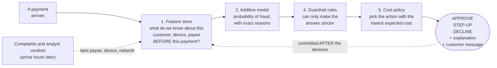

Four ideas hold the whole thing together:

1. **Look at the surroundings, not just the amount.** New device? New payee? Many strangers paying the same account this week? A screen-share running? A SIM changed yesterday?
2. **Explain with arithmetic, not a story.** The model is a sum of per-feature contributions, so the explanation *is* the calculation.
3. **Let rules be strict, never lenient.** A rule can turn an approve into a challenge. It can never turn a decline into an approve.
4. **Choose by cost.** A ₹200 payment and a ₹2 lakh payment with the same fraud probability should not get the same answer.

## What is and is not real

| Real | Simulated or not done |
|---|---|
| **Two real public benchmarks** ([docs/BENCHMARKS.md](docs/BENCHMARKS.md)): the additive model on the ULB card-fraud data (AP 0.76 on a time-ordered split, competitive but not best) and Scam Shield on about 55,000 real text messages. | The behavioural engine on real customers. The real card data has no customer, device or payee ids, and no public Indian customer-level fraud data exists to test it. |
| The code, the maths, the API, the console, the tests. | **All payment data.** It comes from a simulator with eight Indian fraud types and twelve kinds of look-alike legitimate behaviour. |
| Signature-verified Razorpay **test-mode** payments, flowing through the engine. | Real money. Nothing here has touched live money. |
| Real public formulas and rules: NPCI limits, RBI zero-liability circular, the 1930 helpline. | A real bank's customers. The simulator is not a model of any bank. |
| Honest numbers about the simulator, including where it fails. | Evidence the engine works on real fraud. That needs a bank's labelled history. See [feature 37](#37-fit-the-model-to-your-csv). |

---

# Part 1. The engine

## 1. A memory of every customer that never peeks ahead

**The problem.** To judge a payment you need context: what does this customer usually spend, which phones do they use, have they paid this account before, are other people suddenly paying it too? That context has to be computed *before* the payment, or the model quietly learns from the answer.

**Example.** The same ₹22,000 electronics payment gets very different treatment for two customers:

| | Customer A | Customer B |
|---|---|---|
| Usual spend | ₹240 | ₹25,000 (illustrative) |
| This payment is | **91.8×** usual, new phone, new shop | 0.9× usual, usual phone, usual shop |
| Result | **STEP-UP** (real output) | Approve (what you would expect) |

**How it works.** `fh/feat.py` keeps a streaming store and turns each payment into **44 features** from state *before* the payment is committed:

| Group | Examples |
|---|---|
| Amount against this customer | log amount, z-score against their own history, ratio to their largest payment ever |
| Speed | payments in the last minute, 10 minutes, hour, day, and money moved in the last hour |
| Newness | new device, new network, new country, new payee, new category |
| Habits | is this an unusual hour for *this* customer |
| Geography | distance and speed from the last card-present location, distance from home |
| Sharing | how many other accounts used this device or network this week |
| Reputation | fraud complaints against this device, network, payee (7-day window) |
| India-specific | payee is a person or account, **first-time senders to this payee** (mule fan-in), SIM changed recently, screen-share running, approving a collect request |
| Crossings | new device × unusual amount, far from home × unusual amount, and similar |

**Guarantee.** Features come from state before the commit, and a test checks it. Splits are by time, and the first week is burn-in (on day one every payee looks new).

## 2. A model that shows its arithmetic

**The problem.** "The AI says 98%" is useless to an analyst, and impossible to defend to a customer or a regulator.

**Example.** The real explanation for a ₹17,501 decline with the same pattern as Asha's (copied from the Review tab):

```text
typical payment                                     −11.87
+ Screen-sharing or remote-access app active         +3.97
+ First payment to this payee                        +3.05
+ Payee is a person or account, not a merchant       +2.51
+ Payee never seen before anywhere on the platform   +2.30
+ Unusual hour for this customer (01:00 IST)         +2.18
+ 1 other payment in the last 10 minutes             +2.06
+ Amount is 18.0× this customer's typical spend      +1.60
+ Amount ₹17,501                                     +1.44
+ all other small factors                            +6.64
= log-odds 13.87  →  ~100% risk
```

**How it works.** `fh/model.py` is a generalized additive model written from scratch in numpy: boosted, one feature at a time. Because it is a *sum* of per-feature curves, each feature's contribution is the model's own arithmetic, not an after-the-fact guess. The bars plus the baseline add up exactly to the model's output, and a test enforces that. The console draws these as the "Why this score" waterfall.

**Limit.** Additive means no feature interactions beyond the ones listed in feature 1. Pairwise interaction terms are the obvious next step.

## 3. An honest baseline

**The problem.** Every model looks good when nobody compares it to something simple.

**Example.** On the held-out 12 days:

| | This model (GAM) | Plain logistic regression |
|---|---|---|
| ROC AUC | 0.9987 | 0.9990 |
| Average precision | 0.960 | **0.971** |
| Recall at 1% false alarms | 96.8% | **98.0%** |

**The plain logistic model is at least as accurate here.** I ship the GAM because every factor's shape can be inspected (Model card tab) and the explanation is exact, not because it is more accurate. Every fit tool in this repo prints the logistic baseline next to the GAM, so a tie is never hidden.

## 4. Guardrail rules that can only escalate

**The problem.** Some situations are too dangerous or too clear to leave to a probability: a card used in two cities an hour apart, an account paying a number that fifteen other people reported.

**Example.** A real SIM-swap drain: ₹49,500 by IMPS, to a new account, from a brand-new phone, three hours after the SIM changed.

```text
Rules fired: SIM_SWAP_DRAIN, LIMIT_STRUCTURING, NEW_DEVICE_HIGH_VALUE   →  DECLINE (score 77)
```

**How it works.** `fh/rules.py`. The final answer is `max(model's answer, strongest rule)`. A rule can only raise it. Each hit carries a reason code and a plain sentence.

| Code | Fires when | Level |
|---|---|---|
| `IMPOSSIBLE_TRAVEL` | Card used far from its last in-person use, too fast to travel | Block (card-present or new device), else step-up (probably a VPN on a known device) |
| `CARD_TESTING` | 3+ micro-charges in 5 minutes, then another | Block |
| `DEVICE_RING` / `SHARED_NEW_DEVICE` | A device used by many other accounts this week | Block when paying a first-time person, else step-up from ₹10,000 |
| `MULE_PAYEE` | Payee has 2+ recent fraud complaints | Block |
| `BAD_REPUTATION` | Device or network tied to several confirmed reports | Block |
| `SCREEN_SHARE_NEW_PAYEE` / `SCREEN_SHARE_ACTIVE` | Remote-access app active; to a first-time person, or from ₹5,000 | Block / step-up |
| `SIM_SWAP_DRAIN` / `SIM_CHANGE_NEW_DEVICE` | New device within 72 hours of a SIM change; large transfer to a stranger | Block / step-up |
| `PAYEE_FAN_IN` | A first-time payee that 3+ other customers also paid for the first time this week | Step-up, block from 6 |
| `LIMIT_STRUCTURING` | Amount just under ₹50,000 / ₹1 lakh / ₹2 lakh, to a person | Step-up |
| `COLLECT_FIRST_PAYEE` | Approving a collect request from a first-time payee | Step-up |
| `NEW_DEVICE_HIGH_VALUE` | New device with ₹25,000 or more | Step-up |
| `EXCEEDS_UPI_LIMIT`, `NEW_CUSTOMER_HIGH_VALUE` | See [feature 34](#34-amounts-the-model-has-never-seen) | Block / step-up |
| `ANON_NETWORK` | See [feature 35](#35-vpn-proxy-and-data-centre-networks) | Step-up |
| `CONSORTIUM_MULE` | Another bank flagged this payee ([43](#43-banks-warning-banks-keyed-hashes), [44](#44-banks-warning-banks-without-sharing-a-key)) | Block |
| `BLOCKLIST` | An analyst blocked this device, network or customer | Block |

**Proportionate by design.** A screen-share during a ₹40 tea payment is not worth interrupting. A shared kiosk phone is only blocked when paying a stranger. Cyber cafes and CSC kiosks put one phone in many hands, and treating that as fraud would punish honest people.

## 5. The cheapest action wins

**The problem.** One global threshold ("block above 50%") treats a ₹100 payment and a ₹10 lakh payment the same. It is either too loose for big money or too harsh for small money.

**Example.** Real expected costs, in rupees, for a ₹17,501 payment with the same pattern as Asha's (copied from the Review tab):

| Action | Expected cost |
|---|---|
| Approve | **₹18,101** (almost certainly fraud: the amount plus a fixed handling cost) |
| Step-up | **₹1,463** (fraudsters sometimes pass an OTP) |
| **Decline** | **about ₹0** (almost no chance it is a good customer) |

The cheapest wins, so: decline. (For Asha's own ₹18,500 payment the engine printed "expected cost if approved ₹18,716 vs ₹8 for the chosen action".)

**How it works.** `fh/policy.py`:

```text
approve  = p × (loss × amount + fraud handling fee)
decline  = (1 − p) × (margin × amount + churn cost)
step-up  = challenge cost + residual risk + abandonment
```

Choose the smallest. Because "amount" is in the formula, the bar for a challenge **moves with the amount**: a ₹150 payment is approved at risks that would stop a ₹1 lakh payment. The Policy lab ([feature 18](#18-policy-lab)) lets you move every cost and watch decisions change. Defaults: fraud fee ₹600, churn cost ₹400, challenge cost ₹15, 95% of good customers pass a challenge, 8% of fraudsters are assumed to.

**A calibrated policy is only optimal for calibrated scores.** The model's calibration error is 0.0009, which is why this works.

## 6. Each payment rail has its own price

**The problem.** Blocking a good ₹1,000 card payment loses the bank about ₹18 in fees. Blocking a good ₹1,000 UPI payment to a friend loses nothing in fees. A fair policy knows the difference.

**How it works.** The "margin you lose when you wrongly decline" depends on the rail:

| Rail | Margin forgone |
|---|---|
| Card (in person or online) | about 1.8% |
| UPI to a **person**, IMPS, ATM | none |
| UPI to a **merchant** above ₹2,000 | 0.4%, under NPCI's framework effective 15 Oct 2026 |

RBI's July 2017 circular gives customers zero liability when they report an unauthorised transaction within three working days, which is why the model assumes **the bank carries the fraud loss**.

## 7. Two-phase step-up

**The problem.** If the engine trusts a new phone the moment it *asks* for an OTP, a bot just needs to ask.

**Example (real).** A ₹22,000 online payment from a never-seen phone to a never-seen shop:

```text
POST /api/score   → STEP_UP   "Please confirm this ₹22,000 payment to newshop@ybl. Approve it only if you started this payment yourself. Nobody from a bank ever asks for your PIN or OTP."
POST /api/confirm {"id": "...", "passed": true}   → {"ok": true}
```

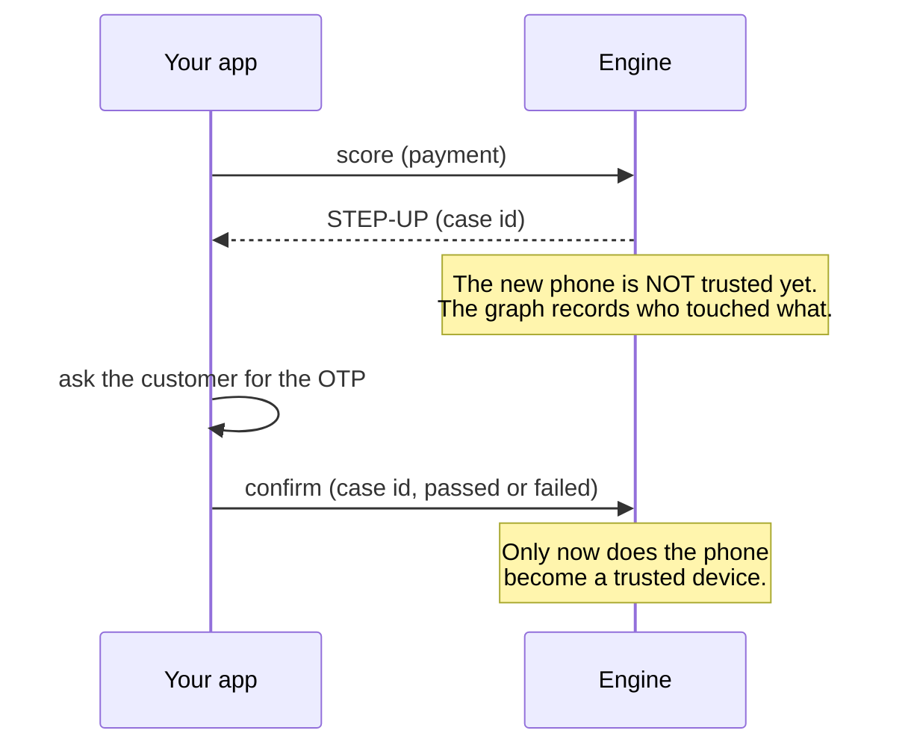

## 8. Attempts count, trust is earned

**The problem.** A bot probing a stolen card makes ten ₹1 charges. All ten get declined. If declined attempts do not count, the engine never notices the burst.

**How it works.** Velocity counts **every attempt**, even declined or pending ones. The behavioural profile (usual spend, trusted devices, known payees) learns **only from payments that were approved or whose challenge was passed**. Splitting the two lifted average precision from 0.934 to 0.960, and let a card-testing bot escalate from a challenge to a block on its fourth charge.

## 9. Complaints arrive late, and scam victims are not suspects

**The problem.** Fraud is reported hours or days later, and there are two very different kinds.

| Kind | Meaning | What it should taint |
|---|---|---|
| **1. Unauthorised** | A thief used the customer's phone or card | The customer's own device and network, and the payee |
| **2. Authorised scam** | The customer was *talked into* paying | **Only the payee.** The victim's phone is perfectly fine. |

**How it works.** Complaints reach the engine 1 to 12 hours late for 80% of simulated fraud. The CSV `label` column has three values: 0 good, 1 unauthorised fraud, 2 authorised scam. My first version treated both the same and **blacklisted scam victims' own phones**, blocking their later genuine payments. Label 2 fixed it.

## 10. Reputation that forgets

**The problem.** A payee reported once, six months ago, is not the same as a payee reported five times this week. Lifetime counts also drifted out of the range the model was trained on.

**How it works.** Complaint counts for each device, network and payee use a **7-day window**. Seven-day windows fixed the drift. They also match reality: rented mule accounts are rotated to stay ahead of complaints.

## 11. Messages in Hindi and English

**The problem.** A decline that says "transaction failed" teaches nothing, and an English-only message misses many customers.

**Example (real).** For the screen-share decline:

> **English:** We stopped a ₹18,500 payment to newperson8841@ybl to protect your account. If this was you, contact your bank. If someone asked you to make this payment, do not go ahead: report it on cybercrime.gov.in or call 1930. A screen-sharing app is running: stop sharing your screen now.

The message tells the customer what to do about *this* scam (here, stop sharing the screen), and never reveals rule logic that a fraudster could probe. A step-up message says "approve only if you started this payment yourself". Hindi versions exist for every message (`fh/explain.py`).

## 12. A drift monitor that does not cry wolf

**The problem.** During Diwali, "normal" changes. A model trained on ordinary weeks can quietly go wrong.

**How it works.** `fh/drift.py` compares recent traffic to the most recent period the model saw, using the **population stability index (PSI)**, minus the PSI that pure sampling noise would produce for that sample size, with the time-of-day feature left out (it changes every hour, legitimately). Press **Festival surge** in the top bar to push festival traffic through and watch the monitor's status react.


## 13. A simulated India to learn from

**The problem.** Banks do not publish their fraud data. Public "UPI fraud" CSVs online are synthetic and too easy.

**How it works.** `fh/gen.py` builds 1,200 customers in 15 cities, 500 merchants, five rails, and **eight fraud typologies**: card testing, cloned card used far from home, a stolen-card splurge online, net-banking account takeover, SIM-swap drain, vishing with screen-share, UPI payee scams (QR, refund, collect) and mule-ring cash-out. It also builds **twelve kinds of legitimate look-alikes** so false alarms cost something: travellers, day-hoppers, people who just got a new phone after a SIM change, VPN users, night owls, rent day, shared kiosk phones. My first simulator was too easy (AUC 1.0), which taught me to add camouflaged fraud and messier honest behaviour.

---

# Part 2. The console

Eleven tabs, one frontend, no build step. Everything below is in `web/`.

## 14. Live ops

**What it is.** Simulated traffic flowing through the real engine, with ground-truth KPIs: fraud stopped, fraud leaked, good customers touched, sales lost to declines, decision latency, approval rate. An India map shows where payments are happening, and a table shows detection by attack type.

**Try this.** Click **Launch attack** (top right) and choose *Vishing with screen-share*. Within seconds the map lights up and the table fills. Click any row in "Live transactions" for the full explanation: a decision ruler whose zones move with the amount and rail, the exact factor waterfall, the expected cost of each action, and what the customer sees in English or Hindi.

The header has a **real India clock** ("Sat 20:53:30 IST") next to the simulator's own clock, because the simulator runs faster than real time (Speed slider). Times in the feed are simulated, and the feed says so.


## 15. Review queue

**The problem.** Payments the engine challenged or declined, which nobody has confirmed yet, need a human answer, and the answer should teach the engine.

**How it works.** `GET /api/queue`. For each case you can **Confirm fraud** (optionally also *block the device, network and payee*), or **Mark legitimate**. The verdict feeds the reputation counters and is written to the audit log. Each case also has **Draft analyst brief** ([feature 32](#32-analyst-copilot-briefs-and-str-drafts)).

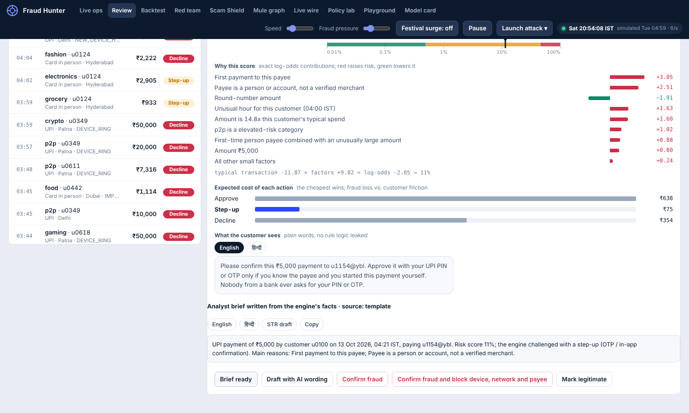

## 16. Backtest: replay your own history

**The problem.** "Would this have worked on *our* payments?" is the first question any bank asks.

**How it works.** Upload a CSV of past payments. The engine replays it, in time order, through an **isolated copy** of itself (nothing live changes), and reports what it would have decided: fraud caught, good customers touched, rupees saved against approving everything, which rules fired, which rails are hit hardest, the 15 riskiest payments, and a CSV of every decision.

```bash
python -m fh.backtest samples/sample_transactions.csv --out decisions.csv
# 66,623 rows (35,575 scored after a 21-day warm-up) in 6.6s: 33,634 approve, 1,317 step-up, 624 decline
# fraud caught 99.0%, good customers touched 3.84%, cost Rs 96,707 vs Rs 1,03,65,047 approving everything
```

The tab accepts almost any common CSV ([feature 36](#36-read-almost-any-csv)). Give it **a month or more**: the engine judges each payment against that customer's own history, so a short file overstates friction. The tool uses a warm-up of up to three weeks and says so when a file is too short.


## 17. Red team: the engine attacks itself

**The problem.** Most fraud demos show a model catching fraud someone wrote *for* it. Real fraudsters search for what slips through.

**How it works.** An evolutionary search over **twelve levers a fraudster controls** (rail, number of payments, total, splitting just under a limit, who is paid, device, network, screen-share, SIM swap, hour, spacing, and whether the customer is tricked into approving a challenge) tries hundreds of strategies against sandboxed copies of real customers' histories, keeping whatever extracts the most rupees.

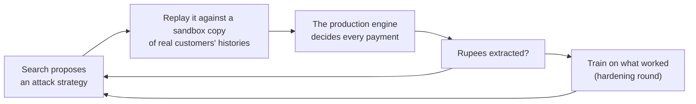

**What it found.** Eight IMPS payments, each just under the ₹50,000 limit, to a gift-card merchant, from the customer's own phone on their usual network, 20 seconds apart, with the customer completing the OTP: about **₹2.6 lakh per customer**, and almost never caught. Two causes: the model had learned that large payments to *known* payees are legitimate (they were rent), and the structuring rule only covered person payees.

| Round | Attacker's median haul per customer | Range over 3 searches | Accuracy (AP) | Fraud caught | Good customers touched |
|---|---|---|---|---|---|
| 0 (shipped) | ₹2.56 lakh | 2.48 to 3.17 lakh | 0.960 | 98.6% | 2.7% |
| 1 | **₹35,400** | 32,300 to 1.20 lakh | 0.960 | 99.0% | 3.1% |
| 2 | ₹28,400 | 27,800 to 32,500 | 0.943 | 99.0% | 4.6% |
| 3 | ₹47,500 | 15,000 to 1.22 lakh | 0.932 | 97.7% | 4.8% |

Round 1 is the best trade: the median haul falls 86% for 0.4 points more friction and no loss of accuracy. After that nothing improves reliably, and the best of three searches against round 1 still found ₹1.2 lakh, so the hole is **narrowed, not closed**. The shipped model stays at round 0 because every other number here was measured on it (run the hardened one with `FH_ART=artifacts_hard`).

**What this does not prove.** The attacker is a search over a fixed menu, not a creative human. It attacks a simulator, assumes a challenge lets through 8% of ordinary fraud and 50% of fraud the customer is tricked into, and plays against rules I also wrote. A clean result means *these* holes are closed.

```bash
python -m fh.redteam                 # attack the shipped model (about 10 seconds)
python -m fh.redteam --harden 3      # attack, train on what worked, attack again (about 6 minutes)
```


## 18. Policy lab

**The problem.** "What if declining a good customer cost us more?" should not need a data scientist.

**How it works.** Move four sliders (cost of fraud, cost of declining a good customer, challenge friction, risk aversion) and the held-out period is **re-decided instantly**. It compares against the best *tuned* thresholds, not a straw man.


## 19. Playground

**What it is.** Compose a payment, or run a ready-made scenario (*chai and groceries*, *SIM-swap drain*, *vishing with screen-share*, *a payee four strangers just paid*, *card-testing burst*, *a teleporting card*) and see the decision, the rules that fired, the waterfall and the customer message. A dry run: nothing is remembered.


## 20. Model card

**What it is.** The honest page: AUC, average precision, recall at fixed false-alarm rates, calibration, importance, the **learned shape of every one of the 44 features**, who gets flagged, and a limitations list. The Fairness report ([feature 24](#24-fairness-who-bears-the-friction)) lives at the bottom.


## 21. Scam Shield: check before you pay

**The problem.** Everything above protects the *bank*. Asha needed a way to check the SMS **before** she called the number.

**How it works.** A tab (and `POST /api/shield`) where anyone pastes a message, a UPI ID or a `upi://pay?...` QR link and gets a verdict in English and Hindi, with what to do. Twenty-six rules in `fh/shield_rules.json` look for known Indian scam patterns. The browser and the server read the **same file**, so the offline demo and the live server cannot disagree.

**Example (real).** Asha's SMS:

```text
Dear customer, your electricity connection will be disconnected tonight 9:30 PM because
last month bill is not updated. Call 9876543210 immediately.

→ DANGER, warning score 64 / 100
   • electricity   (35)  An electricity-bill disconnection warning. One of the most common scam texts in India…
   • threat_urgent (30)  Threatens something bad unless you act right now…
   • call_number   (20)  Asks you to call a personal mobile number. Official notices point to the helpline on your bill…
→ What to do: Do not pay, do not share any OTP or PIN. If money already left: call 1930 now and file at cybercrime.gov.in.
```

| What it spots | Example phrase |
|---|---|
| Asking for OTP, PIN, CVV | "bata do OTP", "share your UPI PIN" |
| "Enter your PIN to **receive** money" | A PIN is only ever needed to *send* |
| Approve a collect request | "approve the request to get your refund" |
| Screen-sharing / remote apps | AnyDesk, TeamViewer, QuickSupport |
| APK files, short links, fake bank domains | `sbi-kyc-update.xyz` |
| "Digital arrest", fake CBI / customs calls | A parcel, a video call, an arrest |
| Fake KYC, prizes, work-from-home tasks | "KYC expire ho gaya", "KBC lottery" |
| Look-alike payment handles | `sbi.refund.support@ybl` |

**On a live server it also does three things the demo cannot:** asks the engine whether the payee has many first-time senders or fraud complaints; with `RAZORPAY_KEY_ID`/`RAZORPAY_KEY_SECRET` set, asks Razorpay who the handle is **registered to** and flags a name that does not match the QR (a QR that says "State Electricity Board" but the handle belongs to "Rakesh Kumar Yadav"); and accepts guarded complaint reports (`POST /api/shield/report`) about a handle.

**Tested on real text messages** (see [docs/BENCHMARKS.md](docs/BENCHMARKS.md)). On a held-out half of about 27,000 real messages it flags **46.4% of real smishing** (it was 7.8% before real data showed me what scams look like) while falsely flagging **0.05% of ordinary texts** (0.06% of 3,487 real texts sent from India). More than half of real smishing is still missed, the smishing data is mostly US, and **the Indian-specific rules are not validated on real Indian scam texts** because I could not reach such a corpus.

**Honest limit.** It reads wording and structure. Without the Razorpay lookup it **cannot tell who owns a handle**, so it never says "safe". The best it says is "no known scam pattern found", and explains why that is not a guarantee. The Razorpay lookup is untested against the live API (the feature must be enabled on your account).

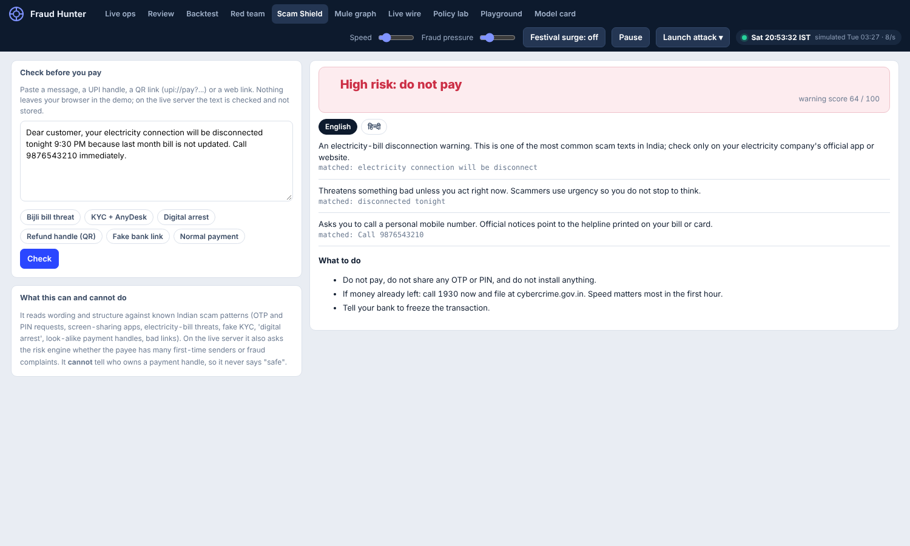

## 22. Mule graph

**The problem.** A mule account is only visible from outside: many unrelated people paying the same private account for the first time, in a burst.

**How it works.** The tab (and `GET /api/graph`) lists payees that 3 or more customers paid this week, as hub-and-spoke pictures, ranked by a **confidence score** that adds four independent kinds of evidence:

| Evidence | Points |
|---|---|
| Most senders had never paid it before | up to 25 |
| Fraud complaints already linked | up to 35 |
| Senders share a device | 20 |
| The money arrived in a burst (within 6 hours) | up to 20 |

**Example (real).** `mu***@okhdfcbank ·3b93`: *5 different customers paid it this week · 5 of them had never paid it before · 3 fraud complaints already linked*, confidence 60 / 100.

It also tells you when a hub **probably is innocent**: *"Most senders had paid it before, which looks like a popular shop, landlord or charity rather than a mule."* An analyst can then press **Confirm mule: block this payee** (adds complaints, so the engine blocks it) or **Known legitimate** (hides it, and stops the first-time fan-in rule from firing on it). Both are written to the audit log. Payee names are masked.

**Honest limit.** Still a lead, not proof. A charity or a popular seller can look like this.

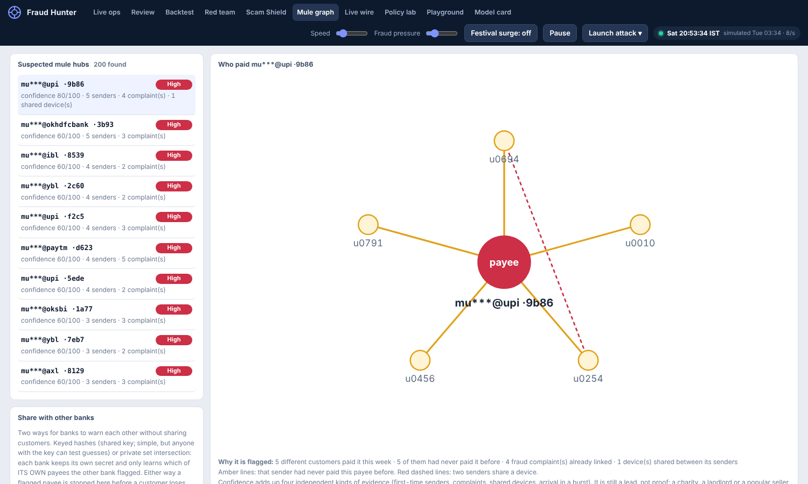

## 23. Live wire

**What it is.** The tab for everything that connects to the outside world: whether each integration is ON or OFF, the latest decisions arriving from Razorpay with their reasons, buttons to send a test payment, test an alert, **run the load test**, and **test the AI wording**, and the exact instructions to point Razorpay at your server.

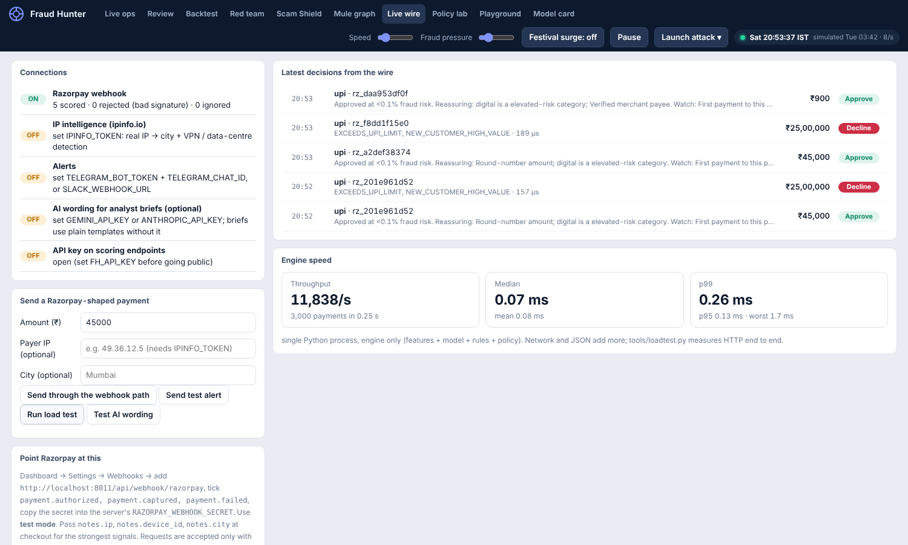

## 24. Fairness: who bears the friction?

**The problem.** A system can have a great overall accuracy and still bother one group of honest customers far more than others.

**How it works.** Replay three simulated days and show, per group of **legitimate** customers, how often they were challenged or declined: by home city, big-city versus smaller-city, travellers, night-time users, payment rail, ticket size, thin versus established history, one phone versus two. Each row has a 95% interval, the ratio to average, and the share of fraud caught. A **flag** needs both: at least 1.5× the average rate, and a difference that survives a **Benjamini-Hochberg correction** across all groups compared (5% false-discovery rate). Without that correction, comparing 34 groups manufactures findings by chance.

**What it found (real).** On average 2.1% of good customers are touched. **IMPS** transfers (11.2%, 5.4× average) and **₹5,000 to ₹50,000** tickets (9.4%, 4.5×) bear the friction, matching the weak spots listed below.

**Honest limit.** The simulator has no age, gender or religion, and a real system must not use them as inputs. For a real audit, see [feature 45](#45-fairness-audit-with-attributes-the-engine-never-saw).

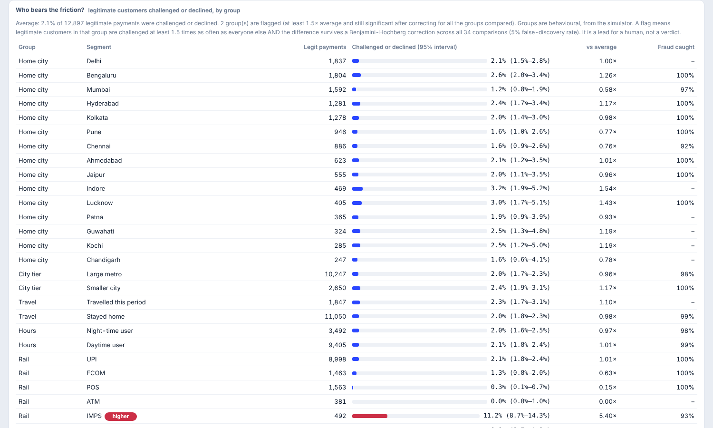

---

# Part 3. Real-world plumbing

Everything here is **off until its environment variable is set**, and **none of it can block scoring**. A table of every variable is in [Reference](#reference), and `.env.example` has them all.

## 25. Razorpay webhook

**The problem.** A risk engine that only sees a simulator proves nothing. This connects it to real (test-mode) payments.

**Example (real).** A signed `payment.captured` event for ₹45,000:

```json
{"ok": true, "payment": "pay_Ab12", "decision": "APPROVE", "risk": 0, "reasons": [],
 "action": "capture", "location": "from notes.city"}
```

and for ₹25,00,000 (25 lakh):

```json
{"ok": true, "payment": "pay_Ab12", "decision": "DECLINE", "risk": 0,
 "reasons": ["EXCEEDS_UPI_LIMIT", "NEW_CUSTOMER_HIGH_VALUE"], "action": "refuse / refund", "location": "from notes.city"}
```

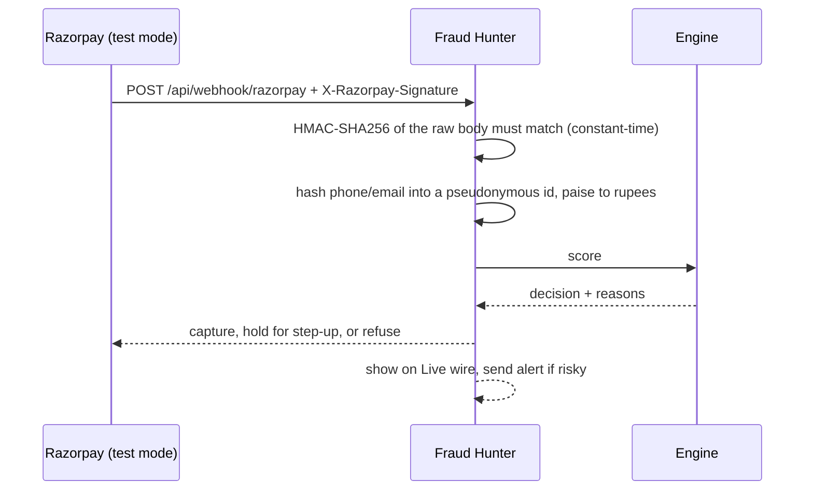

**Set up.** Razorpay Dashboard (Test Mode) → Settings → Webhooks → add `https://your-server/api/webhook/razorpay`, tick `payment.authorized`, `payment.captured`, `payment.failed`, put your own random secret in `RAZORPAY_WEBHOOK_SECRET`. Pass `notes.ip`, `notes.device_id`, `notes.city` when you create the order for the strongest signals.

**Honest limits.** Razorpay is merchant-side, so the payee is always the merchant and payee-graph signals are weak. A webhook arrives *after* authorisation, so the verdict is a hold-or-refund recommendation, not a pre-authorisation block. Raw phone numbers and emails never enter the engine or the audit log.

## 26. IP and network intelligence

**The problem.** Where did this payment really come from, and was it from a data centre?

**How it works.** With `IPINFO_TOKEN`, the payer's IP is looked up (cached, 1.2 second timeout, **fails open**: if the lookup is slow or down, scoring continues). The free **IPinfo Lite** plan gives country and network owner (Amazon, DigitalOcean…), enough for [feature 35](#35-vpn-proxy-and-data-centre-networks). A paid plan (`IPINFO_PAID=1`) adds the city, which feeds the impossible-travel check. Private and reserved addresses are never sent out.

## 27. Telegram and Slack alerts

**Example (the real format; the values are illustrative).**

```text
🔴 DECLINE  ₹18,500  UPI
risk 98%  customer u1095  via razorpay
why: Screen-sharing or remote-access app active while paying a first-time person
```

Every step-up and decline above `FH_ALERT_MIN_AMT` is pushed to a Telegram chat (`TELEGRAM_BOT_TOKEN` + `TELEGRAM_CHAT_ID`) or a Slack webhook. It sends from a **background thread**, so a slow chat app cannot slow a decision. It is rate-limited (`FH_ALERT_PER_MIN`, default 20; the rest are counted, not sent), and the bot token is never echoed, even in errors.

## 28. Load test

**Two ways.** `POST /api/loadtest` (or the button on Live wire) times the engine on an isolated copy of its state. `python tools/loadtest.py http://host --n 2000 --workers 16` measures real HTTP.

| Measurement | Result |
|---|---|
| Engine alone, one Python thread | about **9,000 to 13,000 payments per second**; median 0.07 ms, p99 about 0.25 ms |
| Over HTTP, load generator on the same machine | about 350 requests per second, p50 about 44 ms |

The second number is dominated by the test setup (client and server share one machine), not by the engine.

## 29. API key

Set `FH_API_KEY` and every integration endpoint (score, confirm, feedback, backtest, queue, audit, policy changes, graph verdicts, alerts) requires an `X-API-Key` header, compared in constant time. Unset, the API is **open, which is for development only**. A few endpoints are deliberately public: health, the Scam Shield check (rate-limited to 40 per minute per address, 4,000 characters), and the Razorpay webhook (authenticated by its HMAC signature instead, because Razorpay cannot send custom headers).

## 30. Audit log

Every API score, confirmation, analyst decision, policy change, backtest, graph verdict, brief, PSI query and consortium import is written to SQLite (`FH_AUDIT_DB`) with the **model version**, so you can answer "which model made this call?" later. `GET /api/audit`.

## 31. Remembering state across restarts

The feature store is snapshotted every two minutes and on shutdown (atomic write), and restored on start. On a host with an ephemeral disk this survives a restart but not a redeploy. Snapshots written by an **older version** load safely: new fields get empty defaults instead of crashing (I found that bug by test).

## 32. Analyst copilot: briefs and STR drafts

**The problem.** Analysts spend their day writing the same case note, and compliance teams must write suspicious transaction reports.

**Example (real).** For Asha's payment, "Draft analyst brief" in the Review tab produces:

> UPI payment of ₹18,500 by customer u1095 on 13 Oct 2026, 00:46 IST, paying newperson8841@ybl. Risk score 100%; the engine declined. Main reasons: Screen-sharing or remote-access app active while paying a first-time person.

> UPI से ₹18,500 का भुगतान, ग्राहक u1095, … मुख्य कारण: स्क्रीन-शेयरिंग ऐप चालू है और भुगतान पहली बार के व्यक्ति को जा रहा है।

…plus a **draft suspicious transaction report** (reporting entity, customer, transaction, grounds of suspicion, automated assessment, action taken, recommended follow-up, the 1930 / cybercrime.gov.in complaint number, analyst sign-off) and the same as structured JSON (`str_json`).

**How it works.** `fh/copilot.py`. The decision and every fact come from the engine. The text is a template, so it works with no API key and can be audited. Hindi reasons exist for every rule code.

**Honest limit.** It is a **draft, not the FIU-IND FINnet format**. An analyst must review and complete it.

## 33. Optional AI wording (Gemini or Claude)

**How it works.** With `GEMINI_API_KEY` (Google) or `ANTHROPIC_API_KEY`, the English brief can be reworded by an LLM. Safeguards:

- The model sees **only structured facts**: a pseudonymous customer id, amounts, reason codes, and a **masked payee** (`ra***@okaxis`).
- It is told to add nothing, and its answer is **rejected if it contains any number that was not in the facts**.
- Any failure (no key, wrong model, timeout, blocked answer) falls back to the template silently.
- **The LLM never decides anything.** The decision is always the engine's.

Set the key on the server, open **Live wire** and press **Test AI wording**: it makes one real call on a test case with no customer data and tells you plainly what went wrong (key rejected, model not found, quota, network, answer rejected). `FH_LLM_PROVIDER` and `FH_LLM_MODEL` override the choice. **Free-tier keys may let the provider train on inputs, so do not use them with real customer data.** I could only test this against a fake API, so your first real test is the button.

## 34. Amounts the model has never seen

**What happened (a real bug I found by hand).** I sent a ₹25 lakh UPI payment from a brand-new customer through the webhook. The engine **approved it at under 0.1% risk**. It had never seen an amount like that, so the model extrapolated to "safe".

**The fix.** Two escalate-only rules, plus a regression test:

| Rule | Fires when | Why |
|---|---|---|
| `EXCEEDS_UPI_LIMIT` | A UPI payment above ₹10 lakh | Above every UPI limit; a real UPI payment cannot be this large (it likely means a malformed or fake event) |
| `NEW_CUSTOMER_HIGH_VALUE` | ₹1 lakh or more from a customer with fewer than 4 trusted payments | The model never saw big money from a stranger; do not let it guess |

On the simulator's held-out data these change **no** results (it never produces such payments), which is why they were invisible until a human looked.

## 35. VPN, proxy and data-centre networks

A payment of ₹10,000 or more that arrives from a hosting or VPN network (detected from the network owner's name or, on paid IPinfo plans, its privacy flags) gets `ANON_NETWORK`: approvals become step-ups. Like every rule, it only escalates. It cannot see a home VPN on the free plan, only hosting networks.

---

# Part 4. Your own data

## 36. Read almost any CSV

**The problem.** Nobody's file has the exact column names this project expects.

**Example (real).** A public 100,000-row UPI CSV with columns `timestamp, amount_inr, sender_state, sender_bank, fraud_flag…`:

```bash
python -m fh.ingest upi_transactions_india.csv --out canon.csv
{"ts": "timestamp", "amt": "amount_inr", "chan": "transaction_type", "city": "sender_state", "label": "fraud_flag", "uid": ["sender_state", "sender_bank", "sender_age_group"], ...}
note: no customer id column: customers were approximated by the group (...)
100000 rows -> canon.csv
```

**How it works.** `fh/ingest.py` matches columns by alias (`sender_id`, `nameOrig`, `cc_num` → customer; `amount_inr`, `Amount` → amount), reads timestamps in many formats, maps channel words (P2P, NEFT, CASH_OUT, card…) to the five rails, Indian states to a city, and fraud labels to 0/1. What it cannot find it reports and never invents. `--map uid=sender_id,label=is_fraud` fixes a wrong guess.

## 37. Fit the model to your CSV

**The problem.** The shipped model is trained on a simulator. The only way it becomes useful is by learning from a bank's own history.

```bash
python -m fh.fit data.csv --out artifacts_mine
```

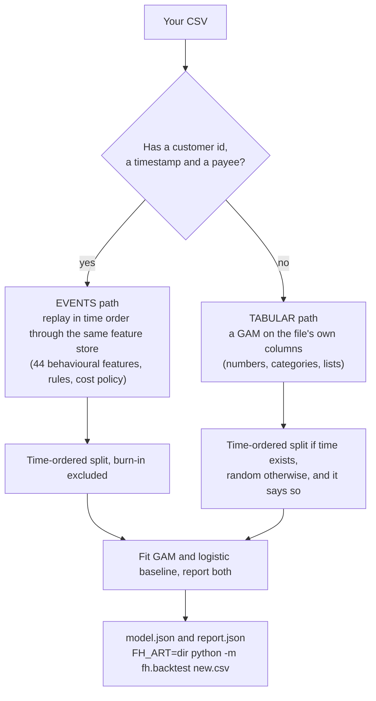

**Example (real).** On a public 10,000-row synthetic UPI file:

```text
events: 10000 rows over 14 days, 250 fraud (2.50%); fitting on 5532, validating on 1276, testing on 1703
GAM  AUC 0.9885  AP 0.7779  recall@1%FPR 0.805
LR   AUC 0.9933  AP 0.9108  recall@1%FPR 0.927   <- baseline; if it ties the GAM, say so
note: the file spans 14 days; behavioural history (new payee, usual amount) is thin, so every number here is pessimistic
```

For tabular files, `python -m fh.fit --predict artifacts_mine new.csv --out scored.csv` gives a probability and the top three reasons per row.

## 38. The leakage guard

**The problem.** Public fraud CSVs often contain a column derived from the label (a `fraud_pattern` column that says "scam" only on fraud rows). A model trains to 100% by reading it.

**How it works.** Columns whose **name** looks like the answer (`fraud`, `scam`, `label`, `pattern`, `risk_score`…) are removed. So is any single column that **alone** separates the classes (AUC above 0.985). They are listed in the report. An overall AUC above 0.995 triggers *"too good to be real: the data is almost certainly synthetic or still leaks the label. Do not quote this number as evidence the model works."* Too few fraud rows is a refusal, not a guess.

**Example (real).** A 65-column public file scored AUC 1.0000. The tool flagged it as unrealistic. A 100,000-row public UPI file scored a realistic AUC 0.87 / average precision 0.23 on a time split.

## 39. Backtest from the command line

`python -m fh.backtest file.csv --out decisions.csv --json summary.json` does what the Backtest tab does. The columns are `ts, uid, amt, chan, mid` plus a location, and optionally `cat, dev, ip, pers, coll, rat, sim, label` (0 good, 1 unauthorised fraud, 2 authorised scam). With labels you get catch rates and money saved; without, you get a picture of what it would have flagged. A 45-day sample ships in `samples/`.

## 40. When the file has no customer id

**What happens.** Some public files have no customer or payee column at all. Instead of failing, the ingest builds stand-ins (sender state + bank + age group as the "customer", merchant category + receiver bank as the "payee"), and **says loudly that this is an approximation**: *"Every 'customer' is really a cohort, so history signals are NOT real customer history. Use this to see the mechanics, not to judge accuracy."*

**Example (real, honest).** Backtesting that 100,000-row file this way caught only ~10% of fraud (AUC 0.66). That is the correct result: the engine's strength is customer history, and the file has none. For such files the tabular fit ([37](#37-fit-the-model-to-your-csv)) is the right tool.

---

# Part 5. Sharing and integrating

## 41. Python and JavaScript SDKs

**Example.**

```python
from fraudhunter import FraudHunter            # sdk/python, standard library only

fh = FraudHunter("https://your-server", api_key="optional")
d = fh.score(uid="u0042", mid="shop@upi", amt=2500, chan="upi", city="Mumbai")
print(d)                                        # <Decision APPROVE risk=0 reasons=->
if d.decision == "STEP_UP":
    fh.confirm(d.id, passed=True)               # after your OTP step
print(fh.shield("Your electricity will be cut tonight, call 9876543210")["level"])   # danger
```

```js
import { FraudHunter } from "./sdk/js/fraudhunter.mjs";            // browser or Node 18+
const fh = new FraudHunter("https://your-server", { apiKey: "..." });
const d = await fh.score({ uid: "u0042", amt: 2500, chan: "upi", city: "Mumbai" });
```

**Safe by design.** The clients retry only what is safe to repeat: GETs and `score(commit=False)`. A committed score changes the customer's history, so it is **never retried silently**. Both clients were run against the real app (Python through the test client, JavaScript against a live server).

## 42. OpenAPI and Postman

`docs/openapi.json` and `docs/FraudHunter.postman_collection.json` (43 operations) are generated from the running app by `python tools/export_openapi.py`, so they cannot drift from the code. FastAPI also serves interactive docs at `/docs` on a running server.

## 43. Banks warning banks: keyed hashes

**The problem.** A mule account that robbed customers at Bank A will rob customers at Bank B next week. Banks cannot hand each other customer data.

**How it works.** Each member turns a flagged payee into a keyed hash (HMAC-SHA256 with a key all members hold) and exports **only the hashes**, with a count and a signature. A member who imports the feed can recognise a payee it has never seen, and learns nothing else: no names, no amounts, no senders. Feeds older than 7 days, tampered feeds, and feeds signed with a different key are rejected. `POST /api/consortium/export` and `/import`, `FH_CONSORTIUM_KEY`.

**Honest limit.** Phone numbers and UPI IDs have little entropy, so **anyone holding the key can test guesses** against the hashes. Which is why feature 44 exists.

## 44. Banks warning banks without sharing a key

**The problem.** Remove the shared key. Let Bank B learn **only which of its own payees Bank A has flagged**, and nothing about the rest.

**How it works.** `fh/psi.py` is a **private set intersection**, standard library only, using a 2048-bit safe prime group (RFC 3526 group 14, checked as a safe prime by a test). Each bank has its own secret.

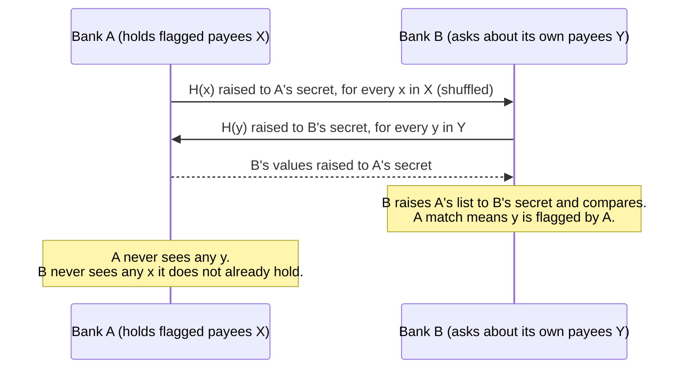

Matches are stored locally, so scoring needs no network call. `POST /api/psi/sync` (peers must be listed in `FH_PSI_PEERS`, so the server cannot be used to fetch arbitrary URLs), `GET /api/psi/set`, `POST /api/psi/reblind`.

**Honest limits.** A malicious member can still ask about many guessed payees, so reblind calls are budgeted (6 per hour, 10,000 values each) and audited. That **raises the cost of probing; it does not end it.** Each side learns the other's list size. This is **not production-audited cryptography**.

## 45. Fairness audit with attributes the engine never saw

**The problem.** A real fairness audit needs age band, gender, state, language. The engine must never use these as inputs. So join them in **afterwards**.

```bash
python -m fh.fairness decisions.csv attributes.csv --by age_band,gender --json report.json
```

`decisions.csv` has `uid, decision, label` (the Backtest download works). `attributes.csv` has `uid` plus the columns to audit. Same statistics as feature 24 (Benjamini-Hochberg across every group compared, plus a 1.5× practical-size rule). **Tests plant a harmed group** and check that exactly that group is flagged, and that equal treatment flags nothing. You provide the data, and you need a lawful basis to hold it.

---

# Part 6. Ship it

One frontend, three ways to host it. [DEPLOY.md](DEPLOY.md) has the details and a troubleshooting table.

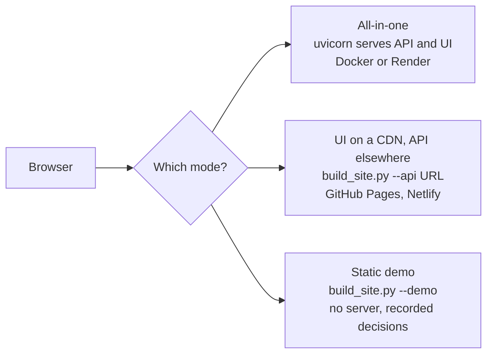

## 46. Docker

`docker compose up --build`, or `docker build -t fraud-hunter . && docker run -p 8000:8000 fraud-hunter`. (The Dockerfile and compose file were written but **not built in my sandbox**, which has no Docker daemon.)

## 47. One-click Render blueprint

`render.yaml` is a Render blueprint. Set the environment variables from `.env.example` in the dashboard. The free plan sleeps when idle (the first request takes 30 to 50 seconds), which matters for webhooks. For always-on, use a small server (EC2, a VPS) behind HTTPS.

## 48. A demo that needs no server

`python tools/build_site.py --demo` builds a backend-free site from **real recorded decisions**. It also produces **one 4 MB HTML file** (`docs/index.html`) that runs from disk. In this mode the Scam Shield runs in the browser, the mule graph, fairness report, briefs and Playground scenarios replay recorded real output, and anything that needs a backend (uploads, webhook, alerts, load test) says so plainly and does not fake a result.

Rebuild it **only** with `make demo` (`tools/rebuild_demo.sh`), which runs the whole sequence and **fails if the Playground scenarios are missing**. (I once broke the demo's Playground by rebuilding it halfway, so the script now refuses to finish in that state.)

## 49. GitHub Pages

The repository root's `docs/` folder is Pages-ready: Settings → Pages → Deploy from a branch → `main` / `/docs`. `docs/index.html` is the offline demo. `docs/live/` is the frontend built to talk to a hosted API (set `FH_ORIGINS` on the API to your Pages address).

## 50. Continuous integration

`.github/workflows/ci.yml` installs the pinned dependencies and runs the test suite on every push.

## 51. Demo video and script

[`docs/demo.mp4`](docs/demo.mp4): a captioned walkthrough filmed from the real UI. [`docs/DEMO_SCRIPT.md`](docs/DEMO_SCRIPT.md): a talk track, a 30-second Live wire scene, and prepared answers to the hard questions ("why synthetic?", "why not logistic regression?", "is it safe for real money?"). [`docs/RESUME_BULLETS.md`](docs/RESUME_BULLETS.md): what you can honestly claim, and what not to.

## 52. One-line commands

```bash
make setup     # pip install -r requirements.txt
make train     # python -m fh.train
make run       # uvicorn fh.api:app --port 8000 --workers 1
make test      # python -m pytest -q tests
make site API=https://your-api     # frontend for a hosted API
make demo      # rebuild the backend-free demo, end to end
```

---

# Part 7. Real public data

## 53. The Real data tab

**The problem.** Everything in the console runs on a simulator, so a judge, a recruiter or you can fairly ask: "is any of this tested on anything real?" This tab answers with a button instead of a document.

**What you can do, with no terminal and no file to upload first:**

| Step | What happens |
|---|---|
| **Download from source** | The server fetches the dataset from its fixed public address (never an address you type, so it cannot be pointed elsewhere). Each file is parsed and its counts checked against the published ones: *"ON THE SERVER, VERIFIED, 284,807 rows, 492 fraud"*. A file that does not match says so. |
| **Upload my own copy** | For anything not on the server, or to test your own file. Streamed to disk under a size limit and **parsed before it is accepted**, so a wrong file never replaces a good one. Uploads are off unless `FH_API_KEY` (recommended) or `FH_ALLOW_UPLOADS=1` is set. |
| **1. Run on the real card-fraud data** | Fits the additive model and logistic regression on the earliest 65% of 284,807 real transactions and tests on the latest 20% (75 fraud). Shows AUC, average precision, a bootstrap interval and recall, next to the outside baselines (scikit-learn) recorded earlier. About 20 seconds. |
| **2. Replay real card transactions** | The real test period, payment by payment, scored by the model you just fitted: *flagged or approved* against *REAL FRAUD or genuine*, with running counts of fraud caught, fraud missed and genuine payments flagged. A speed control and **Jump to the next real fraud**. |
| **3. Scam Shield on real text messages** | Runs the 26 rules over the held-out half of about 27,000 real messages. Plus, on the **Scam Shield tab**, buttons that load *a real smishing text*, *a real spam*, *a real ordinary SMS* or *a real SMS from India* with its true label, so you can see it get one right or wrong. |

**Example (real numbers, from running the tab):** fit on the real data in 20 seconds; additive model average precision **0.760** (95% interval 0.670 to 0.843), logistic regression 0.704; at the replay's threshold the model catches **64 of the 75 real frauds** and flags **448 of about 56,000 genuine payments**.

**Honest limits.**
- The card data was anonymised with PCA and has **no customer, device or payee ids**, so it tests the *model*, not the behavioural feature store or the guardrail rules. No public dataset with customer-level history and Indian payment fraud exists that I could find.
- With 75 fraud in the test set, the gaps between models are inside the intervals.
- The smishing data is mostly US and English. **The Indian-specific rules are not validated on real Indian scam texts.**
- The ULB download address (a public Google storage file used in a TensorFlow tutorial) could not be reached from the sandbox where this was built, so that one download path is untested; the same code was tested with the real file, and the other three datasets were downloaded end to end. If it fails on your server, upload the file instead.
- Results are on the server you run it on: nothing is stored in the repository.

## 54. Data provenance on every tab

Every tab now starts with a one-line strip that says what kind of data it shows, so nothing real can be confused with something simulated.

| Tab | Label | Meaning |
|---|---|---|
| Live ops, Review, Red team, Mule graph, Policy lab, Model card | **SIMULATED** | Generated by the simulator. There is no public stream of real Indian payments to replace it with. |
| Live wire | **REAL (Razorpay TEST MODE)** | Signed webhook events from Razorpay's test mode. |
| Real data | **REAL PUBLIC DATA** | Real card transactions and real text messages from public research datasets. |
| Backtest, Scam Shield, Playground | **YOUR FILE / YOUR INPUT** | Whatever you give it. |

**What I could not make real.** Live ops, the review queue, the mule graph, the fairness report and the red team all need customer-level payment histories with fraud labels, which no public source provides for Indian payments. They stay simulated and say so on the tab. The honest way to make them real is a bank's data in shadow mode ([feature 37](#37-fit-the-model-to-your-csv)).

---

# The numbers and the honesty

## Measured results

Held-out last 12 simulated days: **53,789 payments, 908 fraud**. Everything is on the shipped (round 0) model, and all of it is simulated data.

| | GAM (shipped) | Logistic baseline |
|---|---|---|
| ROC AUC | 0.9987 | 0.9990 |
| Average precision | 0.960 | 0.971 |
| Recall at 1% false alarms | 96.8% | 98.0% |
| Recall at 0.1% false alarms | 86.6% | 89.7% |
| Calibration error (ECE) | 0.0009 | 0.0007 |

**What the cost policy buys** (same 12 days, default costs):

| Approach | Total cost | Fraud caught | Good customers touched |
|---|---|---|---|
| **This policy (amount- and rail-aware)** | **₹1.34 L** | 98.6% | 2.7% |
| Best *tuned* step-up + decline thresholds | ₹1.66 L | 99.0% | 3.2% |
| Best tuned single threshold | ₹3.52 L | 95.7% | 0.6% |
| Untuned: decline above 50% | ₹10.9 L | 85.0% | 0.1% |
| Hard rules only | ₹36.5 L | 58.0% | 1.0% |
| Approve everything | ₹1.82 Cr | 0% | 0% |

The tuned baselines were fitted on this very period, which flatters them. The amount-aware policy is still 19% cheaper than tuned tiers and 62% cheaper than the best single threshold.

| Other measurements | Result |
|---|---|
| Backtest on the 45-day sample (35,575 scored payments) | 99.0% of fraud caught, 3.84% of good customers touched, cost about ₹0.97 lakh against ₹1.04 crore for approving everything |
| Red team, shipped model | attacker's median haul ₹2.56 lakh per customer; ₹35,400 after one round of hardening |
| Speed | about 9,000 to 13,000 payments per second on one Python thread, p99 about 0.25 ms |
| Tests | 145 |

## What failed first

The design came after several wrong turns, and they are why it looks the way it does.

| Stage | Observation | What it taught |
|---|---|---|
| First simulator | AUC 1.0 | Too easy to mean anything. Added camouflaged fraud and messier honest behaviour. |
| Lifetime reputation counts | Drifted out of the trained range | Seven-day windows. |
| Blunt rules | Many false declines (VPN users, shared phones) | Make rules proportionate, and escalate-only. |
| One label for all complaints | Scam victims' own phones got blacklisted | Label 2: authorised scams taint the payee only. |
| Velocity ignored declined attempts | A card-testing bot was never noticed | Count every attempt; trust only what was approved. |
| First backtest on a fresh 5-day file | Touched **17%** of good customers (2.7% normally) | The engine needs history: warm-up, warnings, "give it a month". |
| Trusted a phone the moment it was challenged | A bot could exploit it | Two-phase step-up. |
| **₹25 lakh approved from a stranger** | Found by hand through the webhook | Guardrails for amounts the model has never seen ([34](#34-amounts-the-model-has-never-seen)). |
| Older snapshot after an upgrade | Would have crashed on restart | `__setstate__` backfills new fields. |
| Rebuilding the demo halfway | Broke the Playground on the hosted demo | `make demo` now does everything and checks. |

## Where it is weak (shown, not hidden)

- **Step-up is not a silver bullet.** The policy assumes 8% of fraudsters pass an OTP challenge. In the simulator a SIM-swapper receives the OTP, a vished customer reads it out, and a scammed customer approves it, so those pass 45% to 60% of the time. Stopping them takes friction aimed at the scam: first-payee warnings, cooling-off periods, blocking screen-share.
- **Scams without a screen-share** are the hardest case: only about 75% are declined outright.
- **IMPS transfers** touch about 10% of good customers, because large transfers to new beneficiaries look like account takeover. The fairness report shows this.
- **Rent day** (a large first payment to a new account) is flagged about half the time.
- **Shared kiosk phones** still draw about 14% friction.
- **"Never seen on the platform" is stronger in the simulator than it would be in reality**, because every legitimate payee here is an existing customer.
- The **SIM-change signal** assumes telecom data that only some banks receive; the simulator reflects that with 60% coverage.
- **Scam Shield misses most generic smishing.** 46.4% of real smishing flagged; link-only texts, "wrong number" openers and dating baits slip through. See [docs/BENCHMARKS.md](docs/BENCHMARKS.md).
- **Red team:** hardening beyond round 1 does not reliably help, and costs friction.
- **Razorpay** is merchant-side, and a webhook arrives after authorisation.
- Several integrations were tested against **fakes only**: the Razorpay VPA lookup, the Gemini and Claude calls, Telegram and IPinfo from the sandbox, and the Docker build.

## Bounded by design

These limits are in the code:

- **A backtest never touches live state.** It runs in an isolated engine copy; the red team and the load test work on sandboxed copies too.
- **File limits.** Backtest and fit read at most 150,000 rows; uploads are capped at 25 MB; a webhook body at 200 KB; a Scam Shield check at 4,000 characters and 40 a minute per address.
- **PSI is budgeted.** 10,000 values per query, 6 queries an hour, an allowlist of peers.
- **Alerts are rate-limited** and sent from a background thread.
- **IP lookups time out** at 1.2 seconds, are cached, and fail open.
- **The LLM has a 20-second timeout**, sees no raw payee, and is rejected on any invented number.
- **Fail closed on authenticity.** A webhook with a bad or missing signature is rejected (401), and one with no secret configured returns 503.
- **Secrets come from the environment.** They are never logged or returned by the API. The one exception is the private-set-intersection secret: if you do not supply `FH_PSI_SECRET`, one is generated once into `artifacts/psi.key` (mode 0600, git-ignored). API keys and signatures are compared in constant time.
- **Atomic snapshots.** State is written to a temporary file and renamed.
- **Pseudonymous by default.** Phone numbers and emails are hashed on entry; payees are masked in the mule graph and in anything sent to an outside LLM.

## Reference

### Environment variables

Every line is optional. A feature stays off without its variable. `.env.example` lists them all.

| Variable | What it turns on |
|---|---|
| `FH_API_KEY` | Require `X-API-Key` on integration endpoints |
| `FH_ORIGINS` | Allowed browser origins (CORS), comma-separated |
| `FH_ART`, `FH_AUDIT_DB`, `FH_STATE` | Where artifacts and the audit log live; `FH_STATE=0` disables snapshots |
| `RAZORPAY_WEBHOOK_SECRET` | The Razorpay webhook ([25](#25-razorpay-webhook)) |
| `RAZORPAY_KEY_ID`, `RAZORPAY_KEY_SECRET` | Scam Shield's "who owns this handle" lookup |
| `IPINFO_TOKEN`, `IPINFO_PAID` | IP and network intelligence ([26](#26-ip-and-network-intelligence)) |
| `TELEGRAM_BOT_TOKEN`, `TELEGRAM_CHAT_ID`, `SLACK_WEBHOOK_URL` | Alerts ([27](#27-telegram-and-slack-alerts)) |
| `FH_ALERT_MIN_AMT`, `FH_ALERT_PER_MIN` | Alert threshold and rate limit |
| `GEMINI_API_KEY` (or `GOOGLE_API_KEY`), `ANTHROPIC_API_KEY` | AI wording ([33](#33-optional-ai-wording-gemini-or-claude)) |
| `FH_LLM_PROVIDER`, `FH_LLM_MODEL` | Choose a provider or model |
| `FH_CONSORTIUM_KEY` | Keyed-hash sharing ([43](#43-banks-warning-banks-keyed-hashes)) |
| `FH_PSI_PEERS`, `FH_PSI_PEER_KEY`, `FH_PSI_SECRET` | Private set intersection ([44](#44-banks-warning-banks-without-sharing-a-key)) |

### API

`POST /api/score` takes `{uid, amt, cat, chan (upi|ecom|pos|atm|imps), mid, pers?, coll?, rat?, sim?, city, dev?, ip?, ts?, commit?}` and returns the decision, probability, reason codes, exact contributions, expected cost of each action, the explanation and the bilingual customer message. The full list (43 operations) is in [`docs/openapi.json`](docs/openapi.json); the main groups:

| Group | Endpoints |
|---|---|
| Decide | `POST /api/score`, `POST /api/confirm`, `POST /api/feedback`, `GET /api/case/{id}`, `GET /api/case/{id}/brief` |
| Watch | `GET /api/stream` (SSE), `GET /api/queue`, `GET /api/drift`, `GET /api/audit`, `GET /api/health` |
| Try | `POST /api/backtest`, `GET /api/backtest/sample`, `POST /api/redteam/run`, `POST /api/policy/lab`, `POST /api/sim`, `POST /api/attack` |
| Understand | `GET /api/model`, `GET /api/fairness`, `GET /api/graph`, `POST /api/graph/verdict` |
| Protect customers | `POST /api/shield`, `POST /api/shield/report` |
| Connect | `POST /api/webhook/razorpay`, `GET /api/integrations`, `GET /api/wire`, `POST /api/alerts/test`, `POST /api/llm/check`, `POST /api/loadtest` |
| Share | `GET /api/consortium`, `POST /api/consortium/export`, `POST /api/consortium/import`, `GET /api/psi/set`, `POST /api/psi/reblind`, `POST /api/psi/sync` |

## Layout

```text
fh/
  gen.py            synthetic India: customers, merchants, rails, 8 fraud types, 12 look-alikes
  feat.py           streaming feature store (44 features, graphs, windowed reputation)
  model.py          additive model written from scratch in numpy, logistic baseline, metrics
  rules.py          guardrails with reason codes (escalate-only)
  policy.py         expected-cost decision, rail-aware margin
  engine.py         orchestration: features, model, rules, policy, explanation
  explain.py        reasons and bilingual customer messages
  sim.py, drift.py  live simulator, population-stability drift monitor
  train.py          simulate, stream, split by time, fit, evaluate, save
  backtest.py       replay a CSV in an isolated copy
  ingest.py, fit.py read any CSV, fit the model to it, leakage guard
  redteam.py        evolutionary attacker and hardening
  whatif.py         policy lab maths
  shield.py, shield_rules.json    Scam Shield (rules shared with the browser)
  graph.py          mule hubs, confidence, analyst verdicts
  copilot.py        briefs, STR drafts, optional LLM wording
  fairness.py       group comparison, Benjamini-Hochberg, attribute audit
  integrations.py   Razorpay webhook, IP intelligence, Telegram/Slack alerts
  consortium.py     keyed-hash sharing
  psi.py            private set intersection
  audit.py, persist.py   audit log, state snapshots
  realdata.py       real public datasets: fetch, verify, upload, benchmarks, replay
  api.py            FastAPI service, SSE, all endpoints
web/                dashboard: no build step (index.html, lib.js, live.js, tabs.js, shield.js, demo.js, style.css)
sdk/                python/ and js/ clients
tools/              site and demo builders, OpenAPI export, load test, LLM check, video
tests/              145 tests
docs/               screenshots, demo.mp4, openapi.json, Postman collection, static demo
```

## Tests

| Suite | Tests | Covers |
|---|---:|---|
| `tests/test_core.py` | 36 | No-leakage features, the additive model's exact arithmetic, rules, policy, API, API key, audit log, backtest, red team |
| `tests/test_extras.py` | 22 | Scam Shield, mule graph, keyed-hash sharing, copilot, SDK against the real app |
| `tests/test_hardening.py` | 21 | PSI correctness, malformed input and budgets, fairness statistics, graph verdicts, VPA lookup, LLM check and provider choice |
| `tests/test_integrations.py` | 10 | Webhook signatures, paise handling, IP intelligence, alerts and rate limits, load test, big-amount guardrails |
| `tests/test_fit.py` | 6 | CSV mapping, leakage removal, events and tabular fits |
| `tests/test_shield_rules.py` | 27 | One test per Scam Shield rule (26 rules), plus regressions for the false alarms real text messages exposed |
| `tests/test_shield_parity.py` | 1 | The browser and the server implement the same rules identically on every fixture |
| `tests/test_realdata.py` | 9 | The Real data tab's backend: download, verified counts, uploads (off without a key, rejected when wrong), both benchmarks, the replay with its truth, real samples |
| `tests/test_rule_edges.py` | 5 | Where the guardrail rules start and stop firing (Rs 10 lakh, Rs 1 lakh, card-testing bursts, screen-share, structuring) |
| `tests/test_helpers.py` | 6 | Rupee formatting, distance, CSV channel, city and label mapping, name matching |

```bash
python -m pytest -q tests        # about a minute
```

## Limitations

- **Synthetic data.** The most important one. Real performance needs a bank's labelled history and a shadow-mode pilot ([feature 37](#37-fit-the-model-to-your-csv)).
- **Not production-ready for real money.** It has an API key, an audit log and a review queue, but no rate limiting on most endpoints, no role-based access, and no horizontal scaling (state lives in one process; partition by customer or move it to Redis).
- **The additive model is not more accurate than logistic regression here.** It is more inspectable.
- **Personal data.** On real data, device ids, IPs and payee ids are personal data and need a lawful basis, retention limits and access control.
- **Not legal or compliance advice.** The STR draft is not the FIU-IND format. Banks should talk to their compliance team.
- **Private set intersection is not audited cryptography**, and probing is raised in cost, not prevented.
- **Free-tier AI keys** may let the provider use inputs; keep real customer data out.

## With real data, next

Replace the simulator with real complaint feeds and the I4C suspect registry; add interaction terms and monotonic constraints to the model; learn step-up pass rates per attack type from live outcomes; add scam-specific friction (first-payee warnings, cooling-off periods) as a fourth action; move state to Redis or a stream processor; run a champion-challenger harness behind the drift monitor.

## Facts this project relies on

- RBI's circular on [limiting customer liability in unauthorised electronic banking transactions](https://www.rbi.org.in/scripts/FS_Notification.aspx?Id=11040) (6 July 2017): zero liability when reported within three working days, which is why the cost model assumes the bank carries the loss.
- UPI [per-transaction limits](https://www.businesstoday.in/personal-finance/banking/story/npci-to-increase-upi-transaction-limits-for-high-value-payments-from-sept-15-check-updated-limits-493278-2025-09-09): ₹1 lakh for standard and P2P payments, up to ₹5 lakh for some merchant categories. The structuring signal hugs ₹50k, ₹1 lakh and ₹2 lakh.
- NPCI's [0.4% MDR on specified merchant payments above ₹2,000](https://www.khaleejtimes.com/asia/india-charge-some-merchants-up-to-rs300-upi-transactions-over-rs2000), effective 15 October 2026; P2P and smaller payments stay free.
- The I4C [Suspect Registry](https://www.policyedge.in/p/i4c-and-rbih-partner-to-use-ai-for-detecting-mule-accounts-and-financial-fraud) for mule accounts, and the [1930 helpline and cybercrime.gov.in](https://moneylife.in/article/fraud-alert-illegal-payment-gateways-and-mule-bank-accounts/75513.html) used in the customer messages.
- A report that fraudsters are [shifting to India-based mule accounts](https://www.latestly.com/agency-news/business-news-fraudsters-increasingly-using-india-based-mule-accounts-to-move-stolen-money-report-7532900.html/amp), which is why payee-side signals carry so much weight.

These informed modelling assumptions. This is not legal or compliance advice, and the simulator is not a model of any real bank's customers.

## What isn't here

Real payment data, any bank's customers, secrets, and live-money evidence. The public CSVs used to try the CSV tools are downloaded by you, not redistributed here.

## License

MIT. See [LICENSE](LICENSE).
