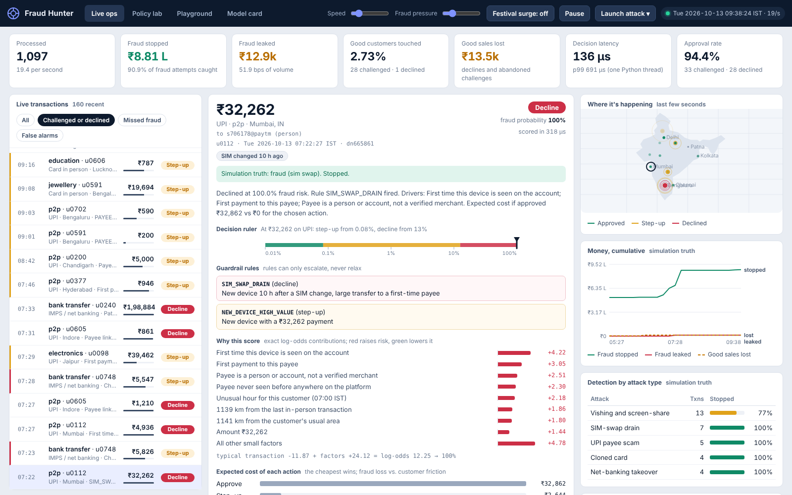
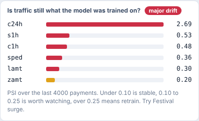
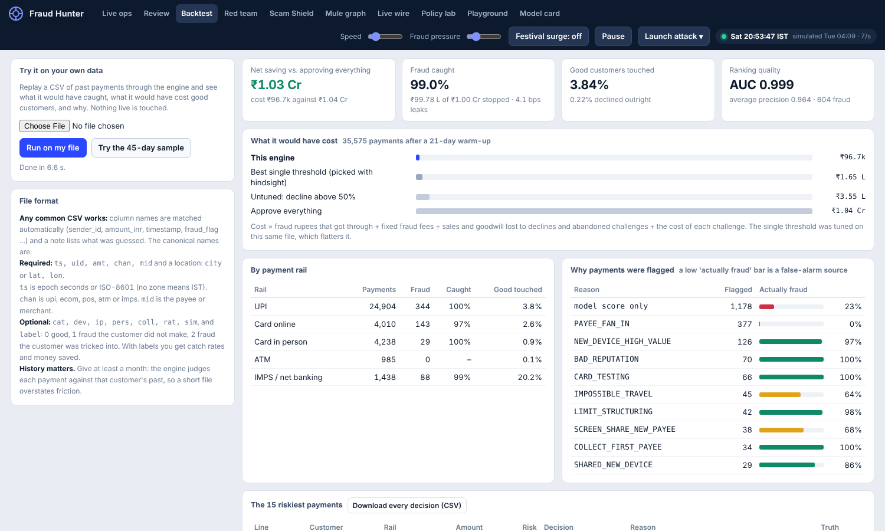
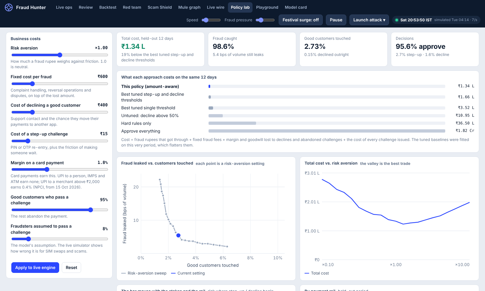
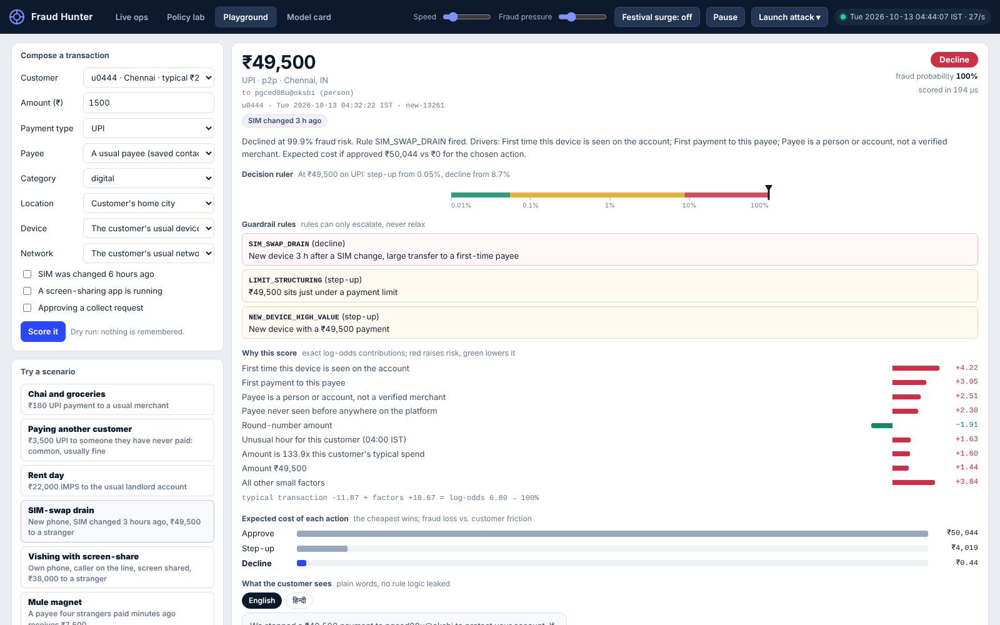
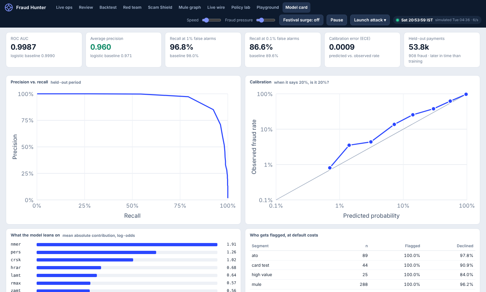
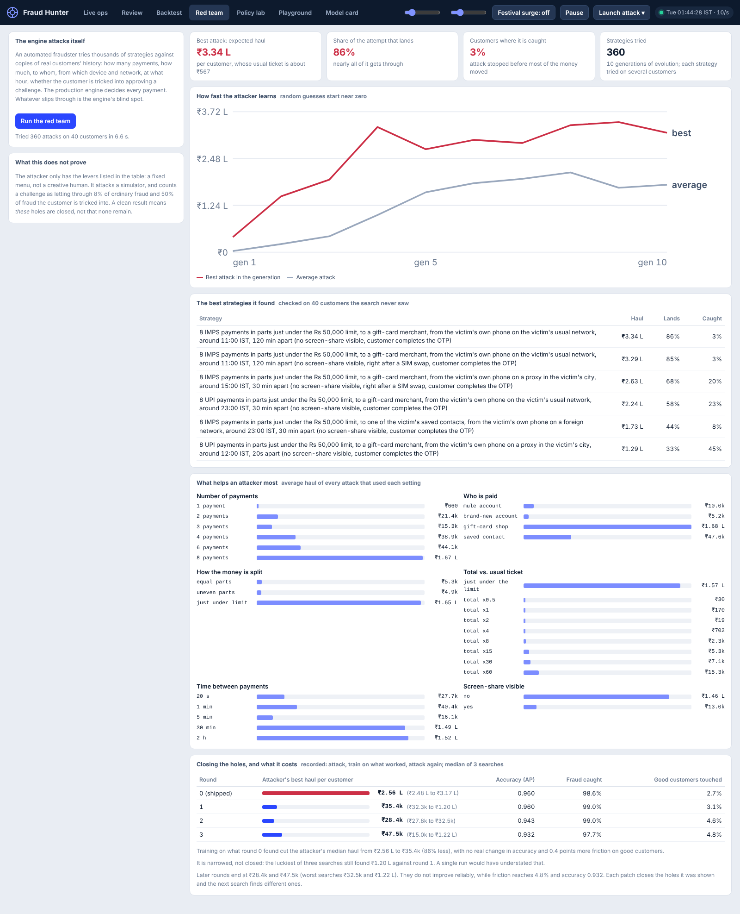

# Fraud Hunter India

A real-time risk engine for Indian digital payments. It scores every UPI, IMPS, card and ATM payment as it arrives, chooses **approve / step-up / decline**, and explains the decision in terms an analyst, or the customer, can act on. The core question is not "is this fraud?" but **"what is the cheapest action, given what fraud costs and what blocking a good customer costs?"**

All data is synthetic. The numbers below show the engineering, not real-world performance.



```
pip install -r requirements.txt
python -m fh.train                          # ~35 s: simulates 42 days, trains, evaluates, saves artifacts/
python -m uvicorn fh.api:app --port 8000    # then open http://localhost:8000
python -m pytest -q tests                   # 36 tests
```
Or `docker build -t fraud-hunter . && docker run -p 8000:8000 fraud-hunter`.

## Why India needs its own engine

Indian payments fraud is dominated by things a card-centric engine barely sees. Each row below is a real signal in this project.

| What happens in India | Signal the engine uses | Where |
|---|---|---|
| Customers are talked into paying a stranger (vishing, QR and refund scams, collect requests) | First payment to a person, **strangers paying the same payee for the first time** (mule fan-in), payee never seen on the platform, complaints against the payee | `feat.py`, rules `PAYEE_FAN_IN`, `MULE_PAYEE` |
| Scammer has the victim share their screen | Screen-share / remote-access app flag, combined with amount and payee novelty | rule `SCREEN_SHARE_NEW_PAYEE` |
| SIM swap, then UPI re-bound on a new phone and drained in near-limit transfers | SIM-change recency x new device, amounts just under Rs 50k / 1 lakh / 2 lakh | rules `SIM_SWAP_DRAIN`, `LIMIT_STRUCTURING` |
| Rented mule accounts, rotated to stay ahead of complaints | 7-day windowed complaint counts per payee, device and network | `feat.py` |
| Cyber cafes and CSC kiosks put one phone in many hands | Shared-device rules only escalate when paying a stranger or moving real money | rule `DEVICE_RING` |
| UPI is about 70% of volume, IMPS carries the big transfers | Per-rail features and per-rail margins in the cost model | `policy.py` |
| Festival peaks change what "normal" looks like | PSI drift monitor; a Festival-surge switch in the UI to see it fire | `/api/drift` |
| Customers read Hindi or English | Bilingual customer message with the scam-safe advice (never share PIN or OTP, call 1930) | `explain.py` |

## Real-time integrations (Live wire tab)

Everything is OFF until its environment variable is set (see `.env.example`); none can block scoring.

| Integration | Variable | What it does |
|---|---|---|
| Razorpay webhook | `RAZORPAY_WEBHOOK_SECRET` | `POST /api/webhook/razorpay` accepts `payment.authorized/captured/failed` only with a valid HMAC-SHA256 signature, hashes phone/email into a pseudonymous id, scores it, and answers with `capture` / `hold for step-up` / `refuse`. Use **test mode**. |
| IP intelligence | `IPINFO_TOKEN` | Free IPinfo Lite gives country + network owner (no city), enough to catch data-centre/VPN-hosted networks; a paid plan (`IPINFO_PAID=1`) adds city for the impossible-travel check. VPN, proxy or data-centre networks on payments of Rs 10,000+ escalate to step-up (`ANON_NETWORK`, escalate-only like every rule). Cached, 1.2 s timeout, fails open. |
| Alerts | `TELEGRAM_BOT_TOKEN`+`TELEGRAM_CHAT_ID`, or `SLACK_WEBHOOK_URL` | Every step-up and decline is pushed with the reason. Background thread, rate limited, secrets never echoed. |
| Load test | none | `POST /api/loadtest` times the engine on an isolated copy; `python tools/loadtest.py http://host --n 2000` measures real HTTP. |

Honest limits: Razorpay is merchant-side, so the payee is always the merchant and the payee-graph signals are weak; the useful inputs are amount, velocity and whatever the merchant passes in `notes` (`ip`, `device_id`, `city`). A webhook arrives after authorisation, so the verdict is a hold/refund recommendation, not a pre-authorisation block. The engine-only benchmark (about 9,000 payments/s, p99 ~0.25 ms on one Python process) excludes network and JSON; over HTTP in this sandbox, with the load generator on the same machine, it was ~350 req/s at p50 44 ms.

## Fit it to your own CSV (`fh.fit`)

```bash
python -m fh.fit data.csv --out artifacts_mine          # auto-detects columns, trains, reports
python -m fh.fit data.csv --map uid=sender_id,label=is_fraud   # fix a column the detector missed
FH_ART=artifacts_mine python -m fh.backtest new.csv      # replay another file with the model you just fitted
python -m fh.ingest raw.csv --out canon.csv              # only convert to the backtest format
```

Two paths, chosen automatically:

- **events** (file has customer id + timestamp + payee): rows are replayed in time order through the same feature store as production (44 behavioural features, guardrails, expected-cost policy). The fitted `model.json` plugs into the backtest.
- **tabular** (pre-engineered columns, no customer history): a GAM on the file's own columns, with per-row reasons via `python -m fh.fit --predict artifacts_mine new.csv --out scored.csv`.

Safety rails: time-ordered split when time exists (random otherwise, and it says so); columns that give the label away (by name or by single-column AUC > 0.985) are removed and listed; AUC above 0.995 triggers a "too good to be real" warning; too few fraud rows is a refusal, not a guess; the logistic baseline is always printed next to the GAM.

Tried on public synthetic UPI datasets: the 100k-row one gives AUC ~0.87 / AP 0.23 (time split); a 65-column one hits AUC 1.0, which the tool flags as unrealistic. None of this is evidence about real bank data.

## A tour

| | |
|---|---|
| **Live ops.** Simulated traffic with ground-truth KPIs, an India map, per-attack detection, and the drift monitor. Launch any attack from the top bar. Click a payment for the full explanation: a decision ruler whose zones move with the amount and rail, exact factor contributions, expected cost of each action, and what the customer sees in English or Hindi. |  |

**Review.** The analyst queue: payments the engine challenged or declined that nobody has confirmed. Confirm fraud (optionally blocking the device, network and payee) or mark legitimate; the answer feeds the engine and the audit log.

**Red team.** The engine attacks itself: an automated fraudster searches for the strategy that extracts the most rupees without being stopped, and the tab shows what it found, which levers matter, and what hardening bought and cost. See below.

**Backtest.** The practical part. Upload a CSV of past payments and the engine replays it in an isolated copy, then reports what it would have caught, who it would have bothered, why, and the rupees saved. `python -m fh.backtest file.csv --out decisions.csv` does the same from the command line.



**Policy lab.** Move the business costs (fraud fee, cost of declining a good customer, challenge friction, risk aversion) and the held-out period is re-decided instantly. It compares against the best *tuned* thresholds, not a straw man.



**Playground.** Compose a payment or run a scenario (SIM-swap drain, vishing with screen-share, a payee four strangers just paid, a teleporting card) and see the decision, the rules that fired and the customer message.



**Video:** [`docs/demo.mp4`](docs/demo.mp4), a 2-minute captioned walkthrough filmed from the real UI. Talk track and Q&A prep in [`docs/DEMO_SCRIPT.md`](docs/DEMO_SCRIPT.md).

**Model card.** AUC, average precision, recall at fixed false-alarm rates, calibration, importance, the learned shape of every feature, who gets flagged, and a limitations list.



## Run it, ship it

One frontend, three ways to host it. [DEPLOY.md](DEPLOY.md) has the details, the integration contract and a troubleshooting table.

| | Command | Needs a server |
|---|---|---|
| All-in-one | `docker compose up --build`, or `uvicorn fh.api:app --port 8000 --workers 1` | One container |
| Frontend on a CDN, API elsewhere | `python tools/build_site.py --api https://your-api` | API only |
| Static demo of real recorded decisions | `python tools/build_site.py --demo` | None |

`render.yaml` is a one-click Render blueprint. The demo build also produces a single 3 MB HTML file that runs from disk.

## Red team: the engine attacks itself

Most fraud demos show a model catching fraud someone wrote for it. This one also attacks itself. An evolutionary search over twelve levers a fraudster controls (rail, number of payments, total, whether to split just under a limit, who is paid, device, network, screen-share, SIM swap, hour, spacing, whether the customer is tricked into approving a challenge) tries hundreds of strategies against sandboxed copies of real customers' histories. The production engine decides every payment, and the search keeps whatever extracts the most rupees.



**What it found in the shipped model.** Eight IMPS payments, each just under the Rs 50,000 limit, to a gift-card merchant, from the customer's own phone on their usual network, 20 seconds apart, with the customer completing the OTP: about **Rs 2.6 lakh per customer**, and almost never caught. The lever chart explains it: splitting just under the limit averages Rs 1.58 lakh per attack, equal parts Rs 5,900. Two causes: the model had learned that large payments to *known* payees are legitimate (they were rent), and the structuring rule only covered person payees, so a merchant slipped past, leaving a step-up that a tricked customer approves.

**Hardening.** Train on what the search found, attack the new model with fresh searches, repeat. Each round is attacked by three independent searches, because one search is noisy: three searches against the same shipped model found Rs 2.5, 2.6 and 3.2 lakh.

| Round | Attacker's median haul per customer | Range over 3 searches | Accuracy (AP) | Fraud caught | Good customers touched |
|---|---|---|---|---|---|
| 0 (shipped) | Rs 2.56 lakh | 2.48 to 3.17 lakh | 0.960 | 98.6% | 2.7% |
| 1 | **Rs 35,400** | 32,300 to 1.20 lakh | 0.960 | 99.0% | 3.1% |
| 2 | Rs 28,400 | 27,800 to 32,500 | 0.943 | 99.0% | 4.6% |
| 3 | Rs 47,500 | 15,000 to 1.22 lakh | 0.932 | 97.7% | 4.8% |

Round 1 is the best trade: the median haul falls 86% for 0.4 points more friction and no loss of accuracy. After that, nothing improves reliably: round 3 is worse than round 2, friction rises to 4.8% and accuracy falls. And the best of three searches against round 1 still found Rs 1.2 lakh, so the hole is **narrowed, not closed**. The shipped model stays at round 0 because every other number in this README was measured on it; run the hardened one with `FH_ART=artifacts_hard`.

**What this does not prove.** The attacker is a search over a fixed menu, not a creative human, and the largest total it can try is 60 times a customer's usual ticket, so the remaining Rs 35,000 is partly a ceiling of the menu. It attacks a simulator, assumes a challenge lets through 8% of ordinary fraud and 50% of fraud the customer is tricked into, and plays against rules I also wrote. A clean result means *these* holes are closed.

```
python -m fh.redteam                 # attack the shipped model (about 10 seconds)
python -m fh.redteam --harden 3      # attack, train on what worked, attack again (about 6 minutes)
```
Also `POST /api/redteam/run` and the Red team tab. Customers are copied into a sandbox for each attack, so nothing live changes.

## Making it practical

| What | How |
|---|---|
| **Try it on your history** | `fh/backtest.py`, `POST /api/backtest` (CSV body) and the Backtest tab. Format and a 45-day sample are in the tab and in the module docstring. |
| **API key** | Set `FH_API_KEY` and every integration endpoint (score, confirm, feedback, backtest, queue, audit, policy changes) requires an `X-API-Key` header. Unset, the API is open, which is for development only. |
| **Audit log** | Every API score, confirmation, analyst decision, policy change and backtest is written to SQLite (`FH_AUDIT_DB`) with the model version. `GET /api/audit`. |
| **Remembering state** | The feature store is snapshotted every two minutes and on shutdown, and restored on start. On a host with an ephemeral disk this survives a restart but not a redeploy. |
| **Two-phase step-up** | `score`, then `confirm`. A challenged payment does not make the engine trust the device until the customer passes. |
| **Review queue** | `GET /api/queue` and the Review tab. |

**What the backtest taught me.** My first run on a fresh 5-day file touched 17% of good customers, against 2.7% in my normal evaluation. Cause: the engine judges each payment against that customer's own history, and some rules (payee fan-in) assume a mature store. On a young store every payment to a friend looks like a stranger paying a mule. So the tool uses a warm-up of up to three weeks, warns when a file is short, and the docs say to give it a month or more. A second run revealed a gap in my own file format: a complaint from a customer who was *tricked* into paying must taint the payee, not the victim's own phone, so the `label` column has a separate value (2) for that. Without it, every scam victim's device was blacklisted.

On the 45-day sample (36k scored payments, 604 fraud) it catches 99.0%, touches 3.8% of good customers, declines 0.22% outright, and costs about Rs 0.97 lakh against Rs 1.04 crore for approving everything. It also shows its misses: payee fan-in flagged 377 payments that were all good, and IMPS transfers touch 20% of good customers.

## Architecture

```
 payment ──► feature store ──► additive model ──► rules ──► cost policy ──► decision + explanation
             (state BEFORE      (exact per-       (can only  (argmin of          + customer message
              this payment)      feature           escalate)  expected cost)
                  ▲              contributions)
                  │ commit after the decision;  complaints arrive hours later
```

| Module | Role |
|---|---|
| `fh/gen.py` | Synthetic India: 1,200 customers across 15 cities, 500 merchants, 5 rails. Eight fraud typologies and 12 kinds of legitimate lookalike. |
| `fh/feat.py` | Streaming features: velocity windows, per-customer profile, travel speed from the last *card-present* location, device / network / **payee** graphs, SIM and screen-share signals, 7-day windowed complaint counts. 44 features. |
| `fh/model.py` | Cyclic Newton-boosted generalized additive model written from scratch in numpy, a logistic baseline, tie-safe metrics. |
| `fh/rules.py` | Guardrails with reason codes. They only escalate. |
| `fh/policy.py` | Expected-cost decision rule with rail-, recipient- and amount-dependent margin. |
| `fh/engine.py`, `fh/explain.py` | Orchestration, latency tracking, reasons, bilingual messages. |
| `fh/sim.py`, `fh/api.py`, `web/` | Live simulator, FastAPI + SSE service, the dashboard (no build step). |

## Design decisions worth defending

1. **No leakage by construction.** Features come from state *before* the payment is committed (tested). Splits are by time, the first week is burn-in (every payee looks new on day one), and the model is evaluated on the most recent 12 days.
2. **Honest labels.** Complaints reach the reputation counters 1 to 12 hours late for 80% of fraud. A complaint about an *authorised* scam (the customer was talked into paying) taints the **payee**, never the victim's own phone. My first version got this wrong and blocked victims' later genuine payments.
3. **Fan-in counts strangers, not friends.** Friends paying each other all week is normal. A mule is identified by *first-time* senders. Counting every sender gave 900 false challenges in one test; counting first-time senders fixed it.
4. **Windowed reputation.** Lifetime counts drifted out of the range the model was trained on. Seven-day windows fixed it.
5. **Exact explanations.** The model is additive, so each feature's contribution is the model's own arithmetic. The bars plus the baseline sum exactly to the logit (tested). No surrogate.
6. **Cost-aware, amount-aware, rail-aware.** `approve = p x (loss x amount + fee)`; `decline = (1 - p) x (margin x amount + churn)`; `step-up = challenge cost + residual risk and abandonment`. The cheapest wins per payment. Margin is a function of the rail: cards earn about 1.8%; UPI to a person, IMPS and ATM earn none; UPI to a merchant above Rs 2,000 earns 0.4% under NPCI's framework effective 15 Oct 2026.
7. **Rules only escalate, and they are proportionate.** An impossible-travel hit blocks card-present use but only challenges an online payment on a *known device* (probably a VPN). A screen-share is only worth interrupting for a person payee or Rs 5,000 and up. A kiosk phone is only blocked when paying a stranger.
8. **Attempts versus trust.** Velocity counts every attempt, even declined or pending ones, because a bot's refused micro-charges are the signal. The behavioural profile (typical spend, trusted devices) only learns from payments that were approved or whose challenge was passed. Splitting the two lifted average precision from 0.934 to 0.960 and let a card-testing bot escalate from challenge to block on its fourth charge.
9. **Two-phase step-up.** `score`, then `confirm`. A challenged payment does not teach the engine to trust its device until the challenge is passed. An earlier version trusted it immediately, which a bot could exploit.
10. **Drift monitoring that does not cry wolf.** PSI against the most recent period the model saw, minus the PSI that pure sampling noise would produce for that sample size, and the diurnal `hrar` feature excluded.

## Results

Held-out last 12 days: 53,789 payments, 908 fraud.

| | GAM (shipped) | Logistic baseline |
|---|---|---|
| ROC AUC | 0.9987 | 0.9990 |
| Average precision | 0.960 | 0.971 |
| Recall at 1% false alarms | 96.8% | 98.0% |
| Recall at 0.1% false alarms | 86.6% | 89.7% |
| Calibration error (ECE) | 0.0009 | 0.0007 |

**The plain logistic model is at least as accurate as the GAM here.** The GAM converged well before its round limit, so it is not undertrained. It is also additive, with exact contributions, so I ship it for the non-linear shapes in the Model card, not for accuracy. Pairwise interaction terms are the obvious next step.

**What the policy buys** (same 12 days, default costs):

| Approach | Total cost | Fraud caught | Good customers touched |
|---|---|---|---|
| **This policy (amount- and rail-aware)** | **Rs 1.34 L** | 98.6% | 2.7% |
| Best *tuned* step-up + decline thresholds | Rs 1.66 L | 99.0% | 3.2% |
| Best tuned single threshold | Rs 3.52 L | 95.7% | 0.6% |
| Untuned: decline above 50% | Rs 10.9 L | 85.0% | 0.1% |
| Hard rules only | Rs 36.5 L | 58.0% | 1.0% |
| Approve everything | Rs 1.82 Cr | 0% | 0% |

The tuned baselines were fitted on this very period, which flatters them. The amount-aware policy is still 19% cheaper than tuned tiers and 62% cheaper than the best single threshold.

**Speed:** the engine alone scores about 12,700 payments per second on one Python thread (p50 61 microseconds, p99 220 microseconds, features through explanation). Inside the live server the UI shows roughly 200 microseconds.

## Where it is weak (shown, not hidden)

- **Step-up is not a silver bullet.** The policy assumes 8% of fraudsters pass an OTP challenge. In the simulator a SIM-swapper receives the OTP, a vished customer reads it out and a scammed customer approves it, so those pass 45% to 60% of the time. Stopping them takes friction aimed at the scam: first-payee warnings, cooling-off periods, blocking screen-share.
- **Scams without a screen-share** are the hardest case: only about 75% are declined outright.
- **IMPS transfers** touch 10.8% of good customers, because large transfers to new beneficiaries look like account takeover.
- **Rent day** (a large first payment to a new account) is flagged 47% of the time.
- **Shared kiosk phones** still draw 14% friction.
- **"Never seen on the platform" is stronger in the simulator than it would be in reality**, because every legitimate payee here is an existing customer. A real bank sees many genuine payees for the first time.
- The SIM-change signal assumes telecom data that only some banks receive; the simulator reflects that with 60% coverage.

## Facts this project relies on

- RBI's circular on [limiting customer liability in unauthorised electronic banking transactions](https://www.rbi.org.in/scripts/FS_Notification.aspx?Id=11040) (6 July 2017): zero liability when reported within three working days, which is why the cost model assumes the bank carries the loss.
- UPI [per-transaction limits](https://www.businesstoday.in/personal-finance/banking/story/npci-to-increase-upi-transaction-limits-for-high-value-payments-from-sept-15-check-updated-limits-493278-2025-09-09): Rs 1 lakh for standard and P2P payments, up to Rs 5 lakh for some merchant categories. The structuring signal hugs Rs 50k, 1 lakh and 2 lakh.
- NPCI's [0.4% MDR on specified merchant payments above Rs 2,000](https://www.khaleejtimes.com/asia/india-charge-some-merchants-up-to-rs300-upi-transactions-over-rs2000), effective 15 October 2026; P2P and smaller payments stay free.
- The I4C [Suspect Registry](https://www.policyedge.in/p/i4c-and-rbih-partner-to-use-ai-for-detecting-mule-accounts-and-financial-fraud) for mule accounts, and the [1930 helpline and cybercrime.gov.in](https://moneylife.in/article/fraud-alert-illegal-payment-gateways-and-mule-bank-accounts/75513.html) used in the customer messages.
- A report that fraudsters are [shifting to India-based mule accounts](https://www.latestly.com/agency-news/business-news-fraudsters-increasingly-using-india-based-mule-accounts-to-move-stolen-money-report-7532900.html/amp), which is why payee-side signals carry so much weight.

These informed modelling assumptions. This is not legal or compliance advice, and the simulator is not a model of any real bank's customers.

## API

`POST /api/score` with `{uid, amt, cat, chan (upi|ecom|pos|atm|imps), mid, pers?, coll?, rat?, sim?, city, dev?, ip?, ts?, commit?}` returns the decision, probability, reason codes, exact contributions, expected cost of each action, the explanation and the bilingual customer message. Also: `GET /api/stream` (SSE), `GET /api/case/{id}`, `GET /api/drift`, `POST /api/feedback`, `GET|POST /api/policy`, `POST /api/policy/lab`, `POST /api/attack`, `POST /api/sim` (speed, pause, fraud pressure, festival surge), `GET /api/model`.

## With real data, next

Replace the simulator with real complaint feeds and the I4C registry; add interaction terms and monotonic constraints to the GAM; learn step-up pass rates per attack type from live outcomes; add scam-specific friction (first-payee warnings, cooling-off) as a fourth action; move state to Redis or a stream processor; run a champion-challenger harness behind the drift monitor.

MIT licensed.
